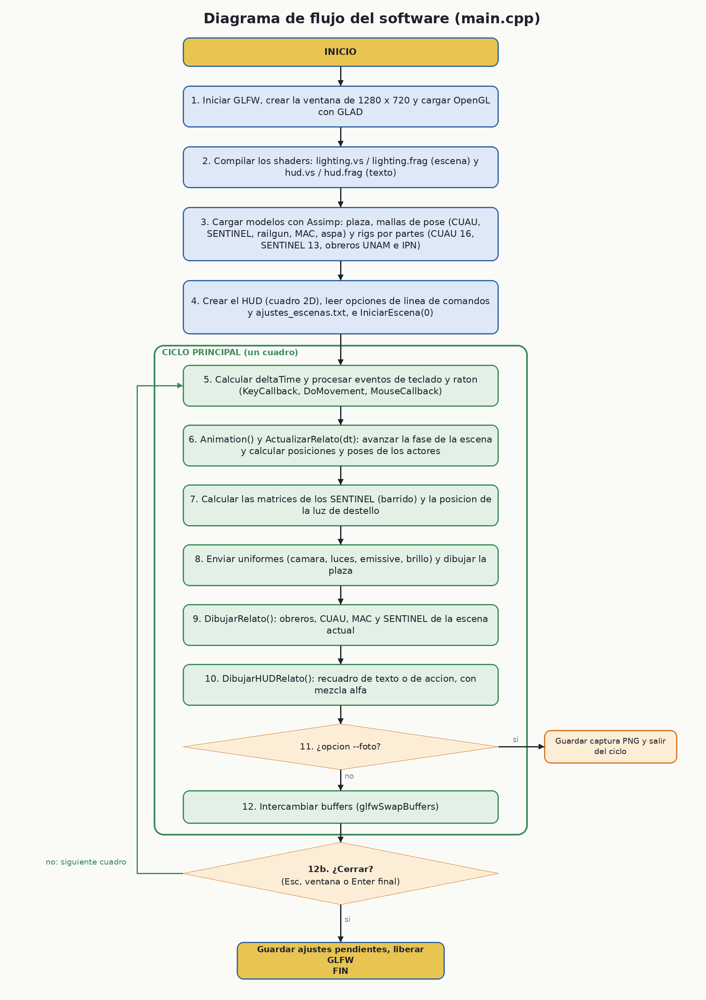
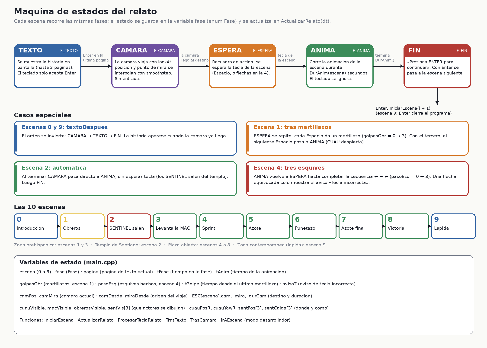
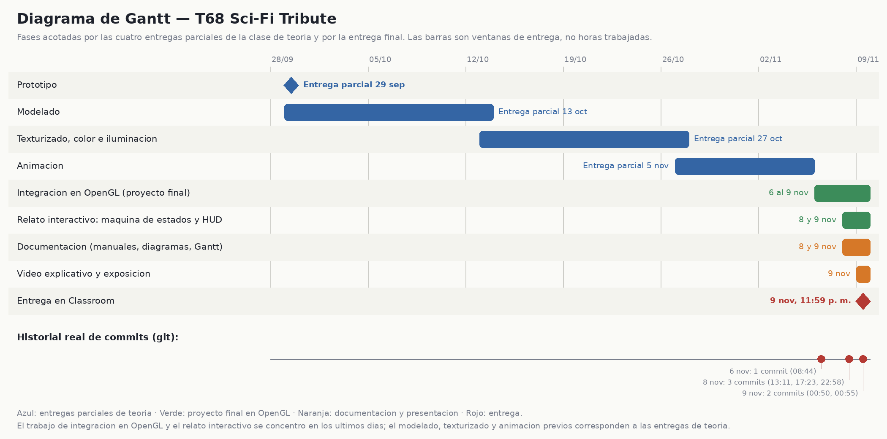

# T68 Sci-Fi Tribute — Manual técnico

**Universidad Nacional Autónoma de México · Facultad de Ingeniería**
Laboratorio de Computación Gráfica · Profesor: Ing. Edén Espinoza Urzúa

Integrantes: **[PENDIENTE: nombres completos del equipo]**
Grupo: **[PENDIENTE]**
Fecha de entrega: 9 de noviembre de 2026
Versión documentada: rama `main`, a partir del commit `0024f94`

---

## Contenido

1. [Introducción y justificación](#1-introducción-y-justificación)
2. [Objetivos](#2-objetivos)
3. [Alcance](#3-alcance)
4. [Limitaciones](#4-limitaciones)
5. [Metodología de desarrollo aplicada](#5-metodología-de-desarrollo-aplicada)
6. [Arquitectura y diagrama de flujo del software](#6-arquitectura-y-diagrama-de-flujo-del-software)
7. [Documentación del código](#7-documentación-del-código)
8. [Fundamentos matemáticos](#8-fundamentos-matemáticos)
9. [Modelado jerárquico por partes](#9-modelado-jerárquico-por-partes)
10. [Máquina de estados del relato](#10-máquina-de-estados-del-relato)
11. [Animaciones](#11-animaciones)
12. [Renderizado e iluminación](#12-renderizado-e-iluminación)
13. [Modelos, materiales y texturas](#13-modelos-materiales-y-texturas)
14. [Pruebas y verificación](#14-pruebas-y-verificación)
15. [Diagrama de Gantt](#15-diagrama-de-gantt)
16. [Conclusiones](#16-conclusiones)
17. [Referencias y créditos](#17-referencias-y-créditos)
18. [Anexos](#18-anexos)

---

## 1. Introducción y justificación

**T68 Sci-Fi Tribute** es un relato gráfico interactivo en 3D, programado en C++ con OpenGL 3.3, que recrea de forma estilizada la **Plaza de las Tres Culturas de Tlatelolco** (Ciudad de México) y la convierte en el escenario de una historia de ciencia ficción: un homenaje al 2 de octubre de 1968. Fue desarrollado como proyecto final del Laboratorio de Computación Gráfica, a partir del código base proporcionado por el profesor (carga de modelos con Assimp, cámara, shaders de iluminación de Phong y ejemplos de modelado jerárquico y de máquina de estados).

**Por qué este proyecto.** El tema une tres lecturas de un mismo lugar: la zona prehispánica, el templo colonial y los edificios contemporáneos. Esa composición se usa como argumento de la historia: CUAU-68 nace en la zona prehispánica, los SENTINEL salen del templo colonial y la lápida final está en la zona contemporánea. Técnicamente, el proyecto reúne lo visto en el curso: modelos importados y texturizados, iluminación con una luz direccional y una puntual dinámica, modelado jerárquico por partes, animaciones por código, una máquina de estados que gobierna la narración y un HUD de texto en 2D.

El proyecto cumple los requisitos de la asignatura: recreación de una fachada y un espacio con al menos siete objetos evaluables, cinco animaciones (tres sencillas y dos complejas) generadas por código, documentación y repositorio de GitHub.

---

## 2. Objetivos

### 2.1 Objetivo general

Desarrollar una aplicación gráfica interactiva en OpenGL que recree la Plaza de las Tres Culturas con ambientación de ciencia ficción y cuente, mediante una máquina de estados y animaciones por código, una historia que rinda homenaje respetuoso al 2 de octubre de 1968.

### 2.2 Objetivos específicos

1. Recrear al menos siete objetos distintos de la plaza (Templo de Santiago, Edificio Chihuahua, plataformas de la zona arqueológica, árboles, bancas, rejas y lápida) con geometría y texturizado adecuados.
2. Integrar cuatro personajes originales (CUAU-68, SENTINEL, MAC y obreros) con materiales completos, y exportarlos tanto como mallas de pose como por **partes con pivotes** para animarlos de forma jerárquica.
3. Implementar **cinco animaciones por código** (tres sencillas y dos complejas), coherentes con el contexto de la historia.
4. Programar una **máquina de estados** que organice el relato en 10 escenas, con una cámara guionizada y una acción de usuario por escena.
5. Mostrar el texto de la historia con un **HUD** nítido, sin bibliotecas de fuentes.
6. Mantener un repositorio versionado, un ejecutable funcional y una documentación completa.

---

## 3. Alcance

**Incluye**

- Recreación estilizada de la plaza: iglesia, edificio moderno, vestigios, árboles, bancas, reja y lápida (un solo modelo OBJ de 56 924 vértices, con 43 materiales).
- Relato de **10 escenas** con cámara guionizada, texto en pantalla y acciones de usuario (`Enter`, `Espacio`, `← →`).
- Modelos originales: CUAU-68 (16 piezas), SENTINEL (13 piezas), MAC (cuerpo y aspa), railgun y obreros UNAM e IPN.
- Cinco animaciones oficiales y movimientos de apoyo (martillazos, caminata, azote, puñetazo).
- Iluminación de Phong con luz direccional y una luz puntual dinámica (destello del railgun).
- Modo desarrollador: cámara libre, salto de escena, edición de posiciones con guardado automático y opciones de línea de comandos para capturas.
- Manual de usuario, manual técnico, diagramas y Gantt.

**No incluye**

- Detección de colisiones ni simulación física.
- Audio.
- Ajuste dinámico del tamaño de la ventana.
- Guardado del progreso del relato.
- Reproducción fotorrealista: la recreación es estilizada, no un levantamiento arquitectónico.
- Ejecutable para Windows (**[PENDIENTE]**, ver sección 4).

---

## 4. Limitaciones

| Limitación | Consecuencia | Observación |
|---|---|---|
| **Sin colisiones ni física.** Las posiciones de los actores son constantes ajustadas a mano. | Un actor puede atravesar geometría si se mueve en el modo edición. | Las alturas del piso se tomaron de `plaza.obj` (plano en y ≈ 0; plataforma a 1.85). |
| **Ventana fija de 1280 × 720.** El *viewport* y la proyección se calculan una vez. | Al redimensionar, la imagen no se adapta. | No hay *callback* de redimensionado. |
| **Ángulo de visión.** `glm::perspective` recibe el valor `45` (el código base lo usa así) y GLM espera **radianes**. | El campo de visión vertical efectivo no es 45° sino ≈ **58.3°** (por la periodicidad de la tangente). | Comprobado con `2·atan(tan(22.5))`. No altera el funcionamiento; se mantiene por coincidir con el código base. |
| **Muestreadores (*samplers*) de GLSL.** `Mesh.h` asigna el nombre `texture_diffuse1`, `main.cpp` define `Material.difuse` y el shader usa `material.diffuse` y `material.specular`. | Ninguno coincide, pero funciona porque todos valen 0 por defecto y apuntan a la unidad de textura 0. | Consecuencia: el mapa especular es la misma textura que la difusa. |
| **Brillo fijo.** `Mesh::Draw` fija `material.shininess = 16`, lo que anula el valor 5 que define `main.cpp`. | El brillo especular es el mismo para todos los modelos. | Efecto visual leve. |
| **Sin PBR.** Los *Metallic* y *Roughness* de Blender no viajan en el OBJ. | Los metales se ven mates; se compensó con el color difuso compuesto en las texturas. | Ver sección 13. |
| **Emisión por uniform.** Visor, luces del casco y «68» se encienden con un uniform (`emissive`/`brillo`), no con un mapa de emisión. | Las piezas «apagadas» usan una versión oscura (`brillo`). | Ver sección 11. |
| **Texto del HUD pregenerado** como imágenes PNG. | Cambiar un texto exige regenerar los PNG con `UI/generar_textos.py`. | Garantiza nitidez y acentos. |
| **Carga al arranque.** Se cargan 41 OBJ y 28 imágenes (algunas de 2048 × 2048). | El programa tarda **≈ 8.3 s** en mostrar el primer cuadro (medido en el equipo de pruebas) y usa ≈ **196 MB** de RAM. | Mediciones propias, 3 corridas. |
| **Rutas relativas.** Los recursos se buscan en `Models/`, `Shader/` y `UI/` del directorio de trabajo. | Hay que ejecutar desde `build/proyecto_lab` o junto a esas carpetas. | CMake crea los enlaces simbólicos. |
| **Luz puntual única.** Hay una sola luz puntual (`NUMBER_OF_POINT_LIGHTS = 1`) y el *spot* queda apagado. | Solo un destello a la vez. | Suficiente para el barrido (ver 11.4). |
| **Plataforma.** Validado en Linux (Debian 13). | La versión para Windows está **pendiente**. | **[PENDIENTE]** |
| **Rendimiento no medido.** No se midieron fotogramas por segundo ni se probó en otras GPU. | Se desconoce el mínimo de hardware. | Solo se probó en una AMD Radeon 610M. |

---

## 5. Metodología de desarrollo aplicada

Se aplicó una metodología **incremental e iterativa**, organizada por las **entregas parciales de la clase de teoría** y cerrada con una integración final en OpenGL.

### 5.1 Incrementos

| Incremento | Fecha | Resultado | Evidencia |
|---|---|---|---|
| Prototipo | 29 de septiembre | Concepto y primer prototipo de los personajes | Entrega de teoría |
| Modelado | 13 de octubre | Modelos de CUAU-68, SENTINEL, MAC y plaza | Archivos `.blend` |
| Texturizado, color e iluminación | 27 de octubre | Materiales y texturas de los modelos | Archivos `.blend` y texturas |
| Animación | 5 de noviembre | Animaciones de los personajes en Blender | Entrega de teoría |
| **Integración en OpenGL** | 6 al 9 de noviembre | Escena, rigs por partes, animaciones por código | Commits `e128f2b` a `99ef023` |
| **Relato interactivo** | 8 y 9 de noviembre | Máquina de estados, HUD y 10 escenas | Commits `d4644c7` y `99ef023` |
| **Documentación** | 8 y 9 de noviembre | Manuales, diagramas y Gantt | Commits `2caa3f9` y `0024f94`, y este manual |

### 5.2 Prácticas

- **Versionado con Git y GitHub**, con un *pull request* para la documentación del compañero (PR #1, integrado en `main`).
- **Iteración con verificación visual.** Cada cambio se compiló y se revisó en pantalla. Para eso se añadieron al programa opciones de línea de comandos que saltan a una escena, simulan teclas y guardan una captura (ver Anexo B); así se detectaron, por ejemplo, cámaras dentro de la iglesia y personajes hundidos en los escalones de la pirámide.
- **Modo edición** (`F3`): permite ajustar posiciones de los actores viendo la escena y luego fijarlas como constantes, lo que acorta el ciclo de ajuste.
- **Pruebas por escena** y una prueba de punta a punta (sección 14).
- **Regeneración reproducible** de recursos: los textos del HUD (`UI/generar_textos.py`), los diagramas (`docs/diagramas/generar_diagramas.py`) y las texturas de los modelos se producen con *scripts*.

### 5.3 Valoración honesta

El **modelado, texturizado y animación** de los personajes avanzaron con las entregas parciales, pero la **integración en OpenGL, el relato y la documentación se concentraron en los últimos cuatro días** (6 al 9 de noviembre, según el historial de git). Es una limitación de planeación: dejó poco margen para pruebas en otros equipos y en Windows. No se llevó un registro de horas; el diagrama de Gantt (sección 15) refleja las ventanas de entrega y los commits reales, no horas trabajadas.

### 5.4 Roles y herramientas

| Rol | Responsable |
|---|---|
| Modelado y texturizado de CUAU-68, SENTINEL, MAC y obreros | **[PENDIENTE]** |
| Modelo de la plaza | Víctor — **[PENDIENTE: nombre completo]** |
| Programación e integración | **[PENDIENTE]** |
| Documentación | **[PENDIENTE]** |

| Herramienta | Uso |
|---|---|
| C++17, OpenGL 3.3, GLSL 330, GLFW, GLAD, GLM, SOIL2, Assimp | Aplicación |
| CMake | Compilación |
| Blender | Modelado, texturizado y exportación OBJ |
| Python y Pillow | Textos del HUD, diagramas y composición de texturas |
| Git y GitHub | Versionado y entrega |
| **[CONFIRMAR: ¿se menciona el uso de asistentes de inteligencia artificial en el código y los textos?]** | |

---

## 6. Arquitectura y diagrama de flujo del software

### 6.1 Estructura del repositorio

```
CMakeLists.txt              raíz: glad, soil2 y subdirectorio proyecto_lab
dependencias/               glad, SOIL2, GLM, Shader.h (base del profesor)
proyecto_lab/
  main.cpp                  programa completo (1310 líneas)
  Camera.h  Mesh.h  Model.h cámara, malla y carga de modelos (base del profesor, con ajustes)
  Shader/                   lighting.vs/.frag (escena) y hud.vs/.frag (texto)
  Models/                   plaza, CUAU-68, SENTINEL, MAC, OBRERO (OBJ, MTL e imágenes)
  UI/                       33 PNG del HUD y generar_textos.py
docs/                       manuales, diagramas, Gantt, referencias
```

### 6.2 Capas

| Capa | Contenido |
|---|---|
| Aplicación | `main.cpp`: relato, rigs, animaciones, HUD y ciclo principal |
| Gráficos | `Model.h`, `Mesh.h`, `Camera.h`, `Shader.h` y los shaders |
| Bibliotecas | GLFW (ventana y entrada), GLAD (funciones de OpenGL), GLM (matemáticas), SOIL2 (imágenes) y Assimp (modelos) |
| Recursos | OBJ, MTL, imágenes y PNG de texto |

### 6.3 Diagrama de flujo del software



*Versión editable: [`diagramas/flujo_programa.mmd`](diagramas/flujo_programa.mmd).*

Cada cuadro del ciclo principal hace, en orden: (5) calcular `deltaTime` y atender eventos; (6) actualizar el relato; (7) calcular las matrices de los SENTINEL y la luz de destello; (8) enviar uniformes y dibujar la plaza; (9) dibujar los actores de la escena; (10) dibujar el HUD; (11) guardar una captura si se pidió con `--foto`; (12) intercambiar buffers.

---

## 7. Documentación del código

### 7.1 Archivos

| Archivo | Líneas | Propósito | Origen |
|---|---|---|---|
| `proyecto_lab/main.cpp` | 1310 | Programa completo: constantes, rigs, relato, HUD, dibujado, entrada | Propio, sobre el ejemplo del profesor |
| `proyecto_lab/Model.h` | 277 | Carga de modelos con Assimp; texturas; tintes de la plaza; caché de texturas | Base del profesor, con ajustes |
| `proyecto_lab/Mesh.h` | 142 | Malla: VAO, VBO, EBO y `Draw` | Base del profesor |
| `proyecto_lab/Camera.h` | 172 | Cámara libre (+ `SetLookAt`) | Base del profesor, con un método añadido |
| `dependencias/Shader.h` | 98 | Compilación y enlace de shaders | Base del profesor |
| `Shader/lighting.vs` / `.frag` | 19 / 173 | Iluminación de Phong de la escena (+ uniformes `emissive` y `brillo`) | Base del profesor, con ajustes |
| `Shader/hud.vs` / `.frag` | 15 / 12 | Dibujo de los cuadros de texto en 2D | Propio |
| `UI/generar_textos.py` | ~100 | Genera los 33 PNG del HUD con Pillow | Propio |
| `docs/diagramas/generar_diagramas.py` | ~250 | Genera los diagramas PNG | Propio |

Los shaders `lamp.*` y `modelLoading.*` pertenecen al código base y no se usan en el relato.

### 7.2 Constantes y estado global (`main.cpp`)

| Grupo | Elementos | Significado |
|---|---|---|
| Ventana | `WIDTH = 1280`, `HEIGHT = 720`, `SCREEN_WIDTH/HEIGHT` | Tamaño solicitado y del *framebuffer* |
| Escalas | `escGrupo[3] = {0.35, 0.35, 0.35}` | Escala de CUAU, SENTINEL y MAC |
| MAC | `MAC_CENTRO (16,0,0)`, `ASPA_Y[3] = {0.30, 2.85, 5.40}`, `MAC_MANO (-3.9,-0.1,0.85)`, `MAC_AGARRE_Y = 4.6` | Centro del modelo, altura de cada aspa y punto de agarre en la mano |
| Rigs | `ALTURA_CUAU = 11.85`, `ALTURA_SENT = 10.78`, `RAILGUN_GIRO_Y = 0` | Altura de la cadera sobre el piso y giro del railgun |
| Disparo | `bocaLocal (-1.15, 12.8, 8.9)`, `RETROCESO_MAX = 0.8` | Boca del railgun (para el destello) y retroceso máximo |
| Puntos de escena | `ZP`, `E1_CUAU`, `E3_CUAU`, `E2_Z_OFF[3]`, `E4_INICIO`, `E4_FIN`, `E4_SENT`, `E5_*`, `E6_*`, `E7_*`, `E8_*` | Posiciones y giros de los actores, tomados del modo edición |
| Cámara del relato | `ESC[10].cam`, `.mira`, `.durCam`; `camPos`, `camMira` | Destino de cada escena y cámara actual |
| Estado | `escena`, `fase`, `pagina`, `tFase`, `tAnim`, `tReloj`, `golpesObr`, `pasoEsq`, `avisoT`, `tGolpe` | Ver sección 10 |
| Actores | `cuauVisible`, `macVisible`, `obrerosVisible`, `sentVis[3]`, `cuauPosR`, `cuauYawR`, `cuauPitchR`, `sentPos[3]`, `sentYaw[3]`, `sentCaida[3]`, `sentRail[3]` | Qué se dibuja y dónde, en cada cuadro |
| Modo desarrollador | `modoRelato`, `camLibre`, `modoEdicion`, `edOff[10][5]` | Banderas y ajustes por escena y actor |

### 7.3 Estructuras y enumeraciones

| Tipo | Campos | Uso |
|---|---|---|
| `PiezaDef` | `archivo`, `padre`, `offset` (vec3), `luz` | Descripción de una pieza de un rig (tablas `DEF_CUAU`, `DEF_SENT`, `DEF_OBRERO_*`) |
| `Pieza` | `modelo` (Model*), `padre`, `offset`, `rot` (grados), `luz`, `visible` | Pieza cargada: su modelo y su pose actual |
| `Rig` | `p` (vector de `Pieza`), `altura`, `luces`, `M` (matrices) | Un personaje articulado. `M` guarda la matriz de mundo de cada pieza del último dibujo |
| `Escena` | `paginas[3]`, `textoDespues`, `cam`, `mira`, `durCam` | Una fila de la tabla `ESC[10]` |
| `TexHUD` | `id`, `w`, `h` | Textura de un PNG del HUD |
| `enum Fase` | `F_TEXTO`, `F_CAMARA`, `F_ESPERA`, `F_ANIMA`, `F_FIN` | Fases de cada escena |
| `enum` de índices | `PELVIS … PIE_D` (12 comunes), `C_CABEZA, C_VISOR, C_LUCES, C_LUZ68`, `S_RAILGUN`, `OB_CUERPO, OB_BRAZO` | Índices de pieza; son **iguales en CUAU y SENTINEL** para las 12 piezas comunes |

### 7.4 Funciones

**Rigs y poses**

| Función | Qué hace |
|---|---|
| `CargarRig(r, carpeta, defs, n, altura)` | Carga cada OBJ de `carpeta/archivo.obj` y arma el rig con su padre y su *offset* |
| `DibujarRig(r, base, shader)` | Recorre las piezas (padres primero), calcula `M = M_padre · T(offset) · Rx · Ry · Rz`, fija `emissive`/`brillo` y dibuja; guarda `r.M` |
| `PoseT(r)` · `PoseReposo(r)` | Todas las rotaciones en 0 (pose T) · de pie con los brazos colgando (±78° en Z) |
| `PoseCaminar(r, t, amp, frec)` | Ciclo de caminata de las 12 piezas comunes |
| `SujetarRailgun(r)` | Contrarresta el giro del brazo derecho para que el arma quede horizontal |
| `AnguloMartillo(t)` | Ángulo del brazo del obrero durante un martillazo |

**Matemáticas auxiliares**

| Función | Qué hace |
|---|---|
| `Suave(u)` | *Smoothstep*: `u²(3 − 2u)` |
| `Clamp01(x)` · `Rampa(t, a, b)` | Limita a [0,1] · `Suave` de `(t − a)/(b − a)`: vale 0 antes de `a` y 1 después de `b` |
| `CaidaSentinel(t)` | Progreso (0 a 1) de la caída con rebote |
| `MezclaMat(A, B, s)` | Mezcla dos matrices rígidas: posición lineal y rotación con *slerp* (disponible; la escena 3 ya no la usa) |
| `AlturaPiso4(x)` | Altura del piso a lo largo del recorrido de la escena 4 |

**Relato**

| Función | Qué hace |
|---|---|
| `IniciarEscena(i)` | Reinicia el estado de la escena `i` y fija su fase inicial |
| `IrAEscena(i)` | Salta a una escena ya lista (modo desarrollador y pruebas) |
| `TrasTexto()` · `TrasCamara()` | Deciden la fase siguiente al terminar el texto o el viaje de cámara |
| `ProcesarTeclaRelato(tecla)` | Aplica `Enter`, `Espacio` y flechas según la fase y la escena |
| `EscenaAzote(t, k, …)` | Cuadro de las escenas 5 y 7 (camina, levanta la MAC, golpea, el SENTINEL cae) |
| `ActualizarRelato(dt)` | Avanza la fase y calcula, para la escena actual, la visibilidad, posición y pose de cada actor |
| `DurAnim(e)` | Duración (s) de la animación de la escena `e` |

**HUD**

| Función | Qué hace |
|---|---|
| `InitHUD()` | Crea el cuadro unitario (VAO/VBO) |
| `HUDTex(nombre)` | Carga perezosa de `UI/nombre.png` como textura |
| `DibujarHUD(shader, nombre, abajo, alpha)` | Dibuja un PNG centrado, escalado a la ventana (las imágenes están al doble de resolución) |
| `PromptActual()` | Elige el recuadro de acción según escena y fase |
| `DibujarHUDRelato(shader)` | Dibuja el texto o el recuadro de acción, con mezcla alfa y sin prueba de profundidad |

**Dibujo y ciclo**

| Función | Qué hace |
|---|---|
| `DibujarRelato(shader, mSent, retro)` | Dibuja obreros, CUAU, MAC y SENTINEL de la escena actual |
| `SetModel(P, m)` | Envía la matriz `model` |
| `main(argc, argv)` | Inicialización, opciones de línea de comandos y ciclo principal |
| `Animation()` | Animaciones comunes: giro de las sierras, tiempo de martillazo y del barrido |
| `KeyCallback` · `DoMovement` · `MouseCallback` | Teclado, movimiento de cámara/grupos y ratón |

**Modo edición**

| Función | Qué hace |
|---|---|
| `ActorVisible(a)` · `SiguienteActor()` | Elige el actor editable (solo entre los visibles) |
| `ImprimirAjustes()` | Imprime posiciones y ajustes de la escena |
| `GuardarAjustes()` · `CargarAjustes()` | Escriben y leen `ajustes_escenas.txt` |

### 7.5 Clases del código base

| Clase | Descripción |
|---|---|
| `Camera` | Cámara libre con ángulos de Euler (*yaw*, *pitch*). `GetViewMatrix()` usa `glm::lookAt(posición, posición + frente, arriba)`. Se añadió `SetLookAt(pos, objetivo)`, que calcula *yaw* = `atan2(f.z, f.x)` y *pitch* = `asin(f.y)`. En el relato la vista sale de `camPos`/`camMira`, no de esta clase. |
| `Model` | Carga un OBJ con Assimp (`aiProcess_Triangulate`, `aiProcess_FlipUVs`). Para cada material: si está en la tabla `TINTES`, genera una textura teñida (`TexturaTenida`); si trae imagen, la carga (`TextureFromFile`, con **caché por archivo**); si no, crea una textura 1 × 1 con el color `Kd` convertido de lineal a sRGB (`TexturaColorPlano`, `c^(1/2.2)`). |
| `Mesh` | Guarda vértices (posición, normal, UV), índices y texturas, y arma el VAO/VBO/EBO. `Draw` enlaza las texturas y dibuja con `glDrawElements`. |
| `Shader` | Compila y enlaza un par de shaders y expone `Program` y `Use()`. |

**Receta de tinte de la plaza** (`TexturaTenida`, para 12 materiales). Para cada píxel, con `c` en espacio lineal (`c = c_sRGB^2.2`): primero la luminancia `g = 0.2126·R + 0.7152·G + 0.0722·B`; luego se reduce la saturación y se sube el valor, `c = (g + (c − g)·0.82)·1.1`; y se mezcla con el color del material, `c = mix(c, tinte, factor)`. Después se convierte de nuevo a sRGB.

### 7.6 Shaders

**`lighting.vs`** calcula `FragPos = model·posición`, la normal `Normal = mat3(transpose(inverse(model)))·normal` y pasa las coordenadas de textura; `gl_Position = projection·view·model·posición`.

**`lighting.frag`** implementa Phong con una luz direccional, una luz puntual y una de foco (apagada):

| Uniforme | Descripción |
|---|---|
| `dirLight`, `pointLights[1]`, `spotLight` | Luces (ver sección 12) |
| `viewPos` | Posición de la cámara |
| `material.diffuse`, `material.specular`, `material.shininess` | Muestreadores y brillo |
| `transparency` | Si vale 1, descarta fragmentos con alfa < 0.1 |
| **`emissive`** (propio) | 0 a 1: suma el color propio de la textura |
| **`brillo`** (propio) | Multiplica la iluminación (1 = normal) |

Color final: `color = vec4(resultado·brillo + emissive·albedo.rgb, albedo.a)`.

**`hud.vs` / `hud.frag`** dibujan un cuadro unitario con `rect = (x, y, ancho, alto)` en píxeles (origen arriba a la izquierda): `p = rect.xy + pos·rect.zw` y `gl_Position = (p.x/screen.x·2 − 1, 1 − p.y/screen.y·2)`. El fragmento muestrea la textura y multiplica el alfa por `alpha`.

---

## 8. Fundamentos matemáticos

### 8.1 Transformaciones y matrices homogéneas

Cada objeto se coloca con una matriz de modelo `M = T · R · S` (traslación, rotación y escala) en coordenadas homogéneas 4 × 4, enviada al shader como `model`. Las rotaciones usan `glm::rotate` alrededor de los ejes unitarios. El orden importa: en `m = translate(m, p); m = rotate(m, θ, Y); m = scale(m, s)` se escala primero, se gira después y se traslada al final.

### 8.2 Modelado jerárquico

Cada pieza hereda la transformación de su padre:

```
M_hijo = M_padre · T(offset) · Rx(rx) · Ry(ry) · Rz(rz)
```

El `offset` es la posición del pivote del hijo respecto al pivote del padre, y como cada OBJ tiene su **origen en su pivote**, rotar la pieza equivale a girarla sobre su articulación. La raíz del rig es la pelvis, elevada `altura` sobre el piso. El orden `Rx · Ry · Rz` aplica `Rz` primero, lo que permite, por ejemplo, **bajar el brazo con `Rz = ±78°` y balancearlo después con `Rx`**.

### 8.3 Cámara y proyección

La vista es `V = lookAt(camPos, camMira, (0,1,0))`. La proyección es `P = perspective(fov, ancho/alto, 0.1, 1000)`, con el fov efectivo de ≈ 58.3° (ver sección 4).

### 8.4 Interpolación y suavizado

| Fórmula | Uso |
|---|---|
| `Suave(u) = u²(3 − 2u)` | Arranque y frenado suaves |
| `Rampa(t, a, b) = Suave(clamp((t − a)/(b − a), 0, 1))` | Progreso de una acción entre `a` y `b` |
| `mix(a, b, s) = a(1 − s) + b·s` | Interpolación lineal (cámara, ángulos) |
| `slerp(q₀, q₁, s)` | Interpolación esférica de rotaciones (`MezclaMat`) |

**Viaje de cámara.** Con `u = clamp(tFase/durCam, 0, 1)` y `s = Suave(u)`: `camPos = mix(camDesde, destino.cam, s)` y `camMira = mix(miraDesde, destino.mira, s)`.

### 8.5 Movimiento periódico y giro por el camino más corto

Los balanceos usan `sin`/`cos` con frecuencia `ω`. Para que un personaje gire hacia una dirección sin dar vueltas de más: `dif = fmod(objetivo − yaw + 540, 360) − 180` y `yaw += dif · min(1, 10·dt)`.

### 8.6 Iluminación de Phong

Para cada luz, con normal `N`, dirección a la luz `L`, dirección al observador `V` y reflejo `R = reflect(−L, N)`:

```
ambiente  = luz.ambient · textura
difuso    = luz.diffuse · max(N·L, 0) · textura
especular = luz.specular · max(V·R, 0)^brillo · textura_especular
```

La luz puntual se atenúa con `1 / (kc + kl·d + kq·d²)`, y la de foco además con un cono entre `cutOff` y `outerCutOff`.

---

## 9. Modelado jerárquico por partes

**Convención de ejes (en el OBJ):** los personajes **miran a +Z**, **+X es su izquierda** y **+Y es arriba**. En Blender el frente es −Y; el exportador lo convierte a +Z. Un giro `+X` en una extremidad que cuelga la lleva **hacia atrás**; `−X` hacia delante.

### 9.1 CUAU-68 (16 piezas)

| Pieza | Padre | Offset al pivote del padre (x, y, z) |
|---|---|---|
| `pelvis` (raíz) | — | (0, 0, 0) |
| `torso` | pelvis | (0, 1.94, −0.01) |
| `luz68` | torso | (0, 0, 0) |
| `cabeza` | torso | (0, 2.12, 0.02) |
| `visor` | cabeza | (0, 0, 0) |
| `luces_casco` | cabeza | (0, 0, 0) |
| `brazo_sup_izq` / `_der` | torso | (±1.86, 0.89, −0.34) |
| `antebrazo_izq` / `_der` | brazo_sup | (±3.16, −0.06, −0.31) |
| `muslo_izq` / `_der` | pelvis | (±0.97, −0.45, −0.20) |
| `pantorrilla_izq` / `_der` | muslo | (±0.34, −4.42, −0.29) |
| `pie_izq` / `_der` | pantorrilla | (±0.19, −5.18, −0.69) |

`visor` (ojos amarillos), `luces_casco` (el cráneo rojo) y `luz68` (el «68» del pecho) son piezas **aparte** para poder encenderlas.

### 9.2 SENTINEL (13 piezas)

Mismas 12 piezas comunes que CUAU (con otros *offsets*: torso `(0, 1.92, 0)`, brazo `(±1.86, 1.11, −0.35)`, antebrazo `(±3.00, −0.08, −0.31)`, muslo `(±1.11, −0.48, −0.20)`, pantorrilla `(±0.20, −3.32, −0.29)`, pie `(±0.19, −5.18, −0.69)`), más el **railgun**, hijo del antebrazo derecho en `(−3.70, 0, 0)`. El torso incluye cabeza y mochila, y el brazo superior izquierdo lleva la placa de texto.

### 9.3 Obrero (2 piezas)

`obrero_cuerpo` (raíz, origen en los pies) y `obrero_brazo` (hijo, pivote del hombro derecho en `(−0.30, 1.45, 0)`), con el martillo ya en la mano. Hay dos variantes de color: UNAM (azul y dorado) e IPN (blanco y vino).

### 9.4 Cómo se obtuvieron los pivotes

En Blender se aplicaron los modificadores *Mirror*, se separaron izquierda y derecha por el signo de X y se trasladó cada pieza para que su origen quedara en la articulación (calculada como el centro de la geometría de la pieza articular). `Models/*/partes/pivotes.txt` guarda cada pivote y su desplazamiento respecto al padre, y de ahí salen las tablas de arriba. Las 12 piezas comunes comparten índice en ambos personajes, por lo que una misma función de pose sirve para los dos.

---

## 10. Máquina de estados del relato



*Versión editable: [`diagramas/maquina_de_estados.mmd`](diagramas/maquina_de_estados.mmd).*

### 10.1 Estados y transiciones

| Estado | Qué ocurre | Entrada aceptada | Sale cuando |
|---|---|---|---|
| `F_TEXTO` | Se muestra la historia (hasta 3 páginas) | `Enter` | Se agotan las páginas |
| `F_CAMARA` | La cámara viaja al destino de la escena | Ninguna | `tFase ≥ durCam` |
| `F_ESPERA` | Recuadro de acción | La tecla de la escena | Se pulsa la tecla correcta |
| `F_ANIMA` | Corre la animación | Ninguna | `tAnim ≥ DurAnim(escena)` |
| `F_FIN` | «Presiona ENTER para continuar» | `Enter` | Se pasa a la escena siguiente |

**Orden normal:** `TEXTO → CAMARA → ESPERA → ANIMA → FIN`.

**Excepciones**

- **Escenas 0 y 9** (`textoDespues`): `CAMARA → TEXTO → FIN`.
- **Escena 1:** `ESPERA` se repite tres veces (un martillazo cada `Espacio`, con `golpesObr` de 0 a 3); con el tercero, el siguiente `Espacio` pasa a `ANIMA`.
- **Escena 2:** al terminar `CAMARA` pasa directo a `ANIMA` (automática).
- **Escena 4:** `ANIMA` vuelve a `ESPERA` hasta completar la secuencia `← → ←` (`pasoEsq` de 0 a 3). Una flecha equivocada activa el aviso `avisoT` y no cambia de estado.
- En `FIN` de la escena 9, `Enter` cierra el programa (`cerrarRelato`).

### 10.2 Las 10 escenas

| # | Escena | Actores visibles | Acción del usuario | Duración de `ANIMA` | Viaje de cámara |
|---|---|---|---|---|---|
| 0 | Introducción | Ninguno | `Enter` | — | 5.0 s |
| 1 | Obreros | Obreros y CUAU (acostado) | `Espacio` ×3, y `Espacio` | 4.2 s | 4.0 s |
| 2 | Salen los SENTINEL | 3 SENTINEL | Ninguna (automática) | 7.0 s | 4.0 s |
| 3 | CUAU levanta la MAC | CUAU y MAC | `Espacio` | 3.8 s | 3.5 s |
| 4 | Sprint esquivando | CUAU (malla de pose) y 3 SENTINEL (mallas `aim`) | `←` `→` `←` | 2.2 s por esquive | 4.0 s |
| 5 | Azote | CUAU, MAC y SENTINEL 1 | `Espacio` | 3.4 s | 3.5 s |
| 6 | Puñetazo | CUAU y SENTINEL 2 | `Espacio` | 3.2 s | 0.8 s |
| 7 | Azote final | CUAU, MAC y SENTINEL 3 | `Espacio` | 3.4 s | 0.8 s |
| 8 | Victoria | CUAU, MAC, 3 SENTINEL caídos y 3 railguns | `Espacio` | 3.6 s | 4.0 s |
| 9 | Lápida | Ninguno | `Enter` | — | 5.0 s |

Al cambiar de escena **se ocultan todos los actores y se muestran solo los de la nueva**; el escenario (la plaza) nunca se borra.

### 10.3 Algoritmo por cuadro (`ActualizarRelato`)

```
tReloj += dt;  tFase += dt
si fase == CAMARA:   interpolar cámara; si llegó → TrasCamara()
si fase en {ANIMA, FIN}: tAnim += dt
si fase == ANIMA y tAnim ≥ DurAnim(escena):
    escena 4: pasoEsq++; tAnim = 0; fase = (pasoEsq ≥ 3) ? FIN : ESPERA
    resto:    fase = FIN
ocultar todos los actores; poner todos los rigs en PoseReposo
si la escena aún no debe mostrarse (TEXTO de escenas 1 a 8): terminar
según la escena: marcar actores visibles y calcular posiciones y poses con t = min(tAnim, DurAnim)
sumar los ajustes del modo edición (edOff)
```

La entrada del teclado la procesa `ProcesarTeclaRelato` y **solo en `TEXTO`, `ESPERA` y `FIN`**; en `CAMARA` y `ANIMA` se ignora.

---

## 11. Animaciones

Todas se generan **por código**, sin fotogramas clave ni videos. Las cinco oficiales:

| N.º | Animación | Tipo | Dónde |
|---|---|---|---|
| 1 | Giro de las sierras de la MAC | Sencilla | Escenas 3, 5, 7 y 8 |
| 2 | Luces del casco de CUAU-68 | Sencilla | Escenas 1, 3 y 5 a 8 |
| 3 | Caída del SENTINEL con rebote | Sencilla | Escenas 5, 6 y 7 |
| 4 | Barrido de los SENTINEL con disparo | **Compleja** | Escena 4 |
| 5 | Sprint esquivando de CUAU-68 | **Compleja** | Escena 4 |

### 11.1 Animación 1 — Giro de las sierras (sencilla)

**Contexto.** La MAC lleva tres hojas circulares de obsidiana; girar da la idea de una sierra mecánica activa. Gira en sentidos alternos para parecer una cadena de piñones.

```
rotAspa += 540°/s · dt                       (Animation(), cuando animSierras)
aspa i:  ángulo = (−1)^i · rotAspa           alrededor del eje Z de la MAC
         posición = (16, ASPA_Y[i], 0),  ASPA_Y = {0.30, 2.85, 5.40}
```

Cada aspa se dibuja con la matriz de la MAC trasladada a su centro y girada. Las sierras se activan en la escena 3 al terminar de levantar la MAC, y siguen activas en las escenas 5, 7 y 8.

### 11.2 Animación 2 — Luces del casco (sencilla)

**Contexto.** Al despertar, el visor, las luces del casco y el «68» se encienden: es el momento en que CUAU-68 «cobra vida».

```
pulso    = 0.5 + 0.5·sin(3·tReloj)                        brillo senoidal
luces    = Rampa(t, 2.0, 2.8) · pulso     (escena 1; luego luces = pulso)
```

Las piezas con `luz = true` (`visor`, `luces_casco`, `luz68`) se dibujan con `emissive = luces` y `brillo = 0.15 + 0.85·luces`. En el shader: `color = resultado·brillo + emissive·albedo`. Apagadas se ven oscuras (`brillo = 0.15`); encendidas, brillan con su propio color y **palpitan con el seno**.

### 11.3 Animación 3 — Caída del SENTINEL (sencilla)

**Contexto.** Tras recibir el golpe, el SENTINEL cae de espaldas y rebota levemente contra el piso.

`t` = segundos desde el impacto (1.35 s en las escenas 5 y 7; 1.45 s en la 6):

```
f(t) = 0                                  t ≤ 0
       (t/0.55)²                          0 < t < 0.55      cae acelerando
       1 − 0.12·sin(π·(t − 0.55)/0.25)    0.55 ≤ t < 0.80   rebote
       1                                  t ≥ 0.80          en el suelo
ángulo = −90° · f        sobre el eje X local, con pivote en los pies
elevación = 2.4 · escala · sin(−ángulo)    para que el cuerpo no se hunda en el piso
```

### 11.4 Animación 4 — Barrido de los SENTINEL (compleja)

**Contexto.** Los tres SENTINEL apuntan a CUAU-68 y le disparan mientras corre. No hay balas: el disparo se **representa** con la sincronización de cuatro efectos.

**Por qué es compleja.** Combina varias partes coordinadas (cuerpo y arma), una **luz dinámica** que se mueve con el arma y tiempos desfasados por personaje; no es una trayectoria lineal ni una rotación sencilla.

Para el SENTINEL `i` (0, 1, 2) y el tiempo `tScar`:

```
yawBase  = atan2(d.x, d.z)            d = posCuau − posSentinel[i]        (apunta a CUAU)
barrido  = A · sin(1.5·tScar + 0.9·i)   A = 14° en el relato (60° en el banco de pruebas)
ciclo    = fmod(tScar + 0.15·i, 0.45)                                    un disparo cada 0.45 s
destello = ciclo < 0.07
retroceso = (1 − ciclo/0.12) · RETROCESO_MAX        si ciclo < 0.12      (RETROCESO_MAX = 0.8)
vibración = 0.08 · sin(120·tScar)                    solo durante el destello (vertical)
giro final = yawBase + barrido
```

- El railgun se desplaza `−retroceso` sobre su eje de disparo (Z local), de modo que **retrocede y regresa**.
- La **luz puntual** se coloca en la boca del arma, `luz = M · T(0, 0, −retroceso) · bocaLocal`, solo durante el destello del primer SENTINEL que dispara; con ambiente `(0.4, 0.25, 0.1)`, difuso `(3.0, 1.8, 0.6)`, especular `(1.0, 0.8, 0.4)` y atenuación `(1, 0.022, 0.0019)`. Fuera del destello la luz vale 0.

### 11.5 Animación 5 — Sprint esquivando de CUAU-68 (compleja)

**Contexto.** CUAU-68 corre hacia los SENTINEL bajando de la pirámide y esquiva los disparos: cada tecla `←` o `→` lanza **un esquive** hacia ese lado de la pantalla.

**Por qué es compleja.** La trayectoria no es lineal: suma avance, un desplazamiento lateral curvo, un salto y una inclinación, y el giro del cuerpo **sigue la velocidad** con suavizado, con la altura del piso variable.

Con `E4_INICIO`, `E4_FIN` el recorrido, `largo = |E4_FIN − E4_INICIO|` (en el plano), `dirAv` su dirección unitaria, `derCam` la derecha de la pantalla en el piso (`(−v.z, 0, v.x)` normalizado, con `v = mira − cam`), `T = 2.2 s` y `u = tAnim/T` en [0, 1]:

```
lado[k]   = −1, +1, −1                                   (k = 0, 1, 2: ←, →, ←)
adelante  = (esquives hechos + u) · largo/3              cada esquive avanza un tercio
lateral   = lado[k] · 4 · sin(π·u)                       sale 4 unidades y regresa
salto     = 1.6 · sin(π·u)
posición  = E4_INICIO + dirAv·adelante + derCam·lateral + (0, AlturaPiso4(x) + salto, 0)
velocidad = dirAv·(largo/3/T) + (derCam·lado[k])·(4π/T)·cos(π·u)
objetivo  = atan2(velocidad.x, velocidad.z)
yaw      += dif · min(1, 10·dt),   dif = fmod(objetivo − yaw + 540, 360) − 180
inclinación = 18° · sin(π·u) · (+1 si el esquive va hacia la derecha del personaje; −1 si no)
```

`AlturaPiso4(x)` vale 1.85 para `x ≤ −7` (plataforma), 0.04 para `x ≥ −3.3` y baja linealmente entre ambos (los escalones).

### 11.6 Movimientos de apoyo

| Movimiento | Dónde | Descripción |
|---|---|---|
| **Martillazo** | Escena 1 | `AnguloMartillo(t)`: levanta el brazo a −165° (0 a 0.40 s, con `Suave`), golpea a −40° (0.40 a 0.50 s, `−165 + 125u²`), rebota a −62° (0.50 a 0.60 s) y regresa a 0 (0.60 a 0.95 s). Los seis obreros se desfasan `0.08·i` s |
| **Despertar** | Escena 1 | `lev = Rampa(t, 0.2, 3.0)`; la inclinación del cuerpo es `−90°·(1 − lev)`, con la elevación `2.9·escala·sin(−inclinación)` para no hundirse |
| **Caminata** | Escena 2 | `PoseCaminar(t, 24°, 6.5)`: muslo `∓A·sen(ωt)`, rodilla `1.3·A·max(0, ±cos(ωt))`, pie `−0.7·(muslo + rodilla)`, brazos `±0.7·A·sen(ωt)` con `Rz = ±78°` y contragiro del torso `4°·sen(ωt)`. Los SENTINEL salen con 1.4 s de diferencia y `z = max(12.5 − 5·tt, zAlto) + desplazamiento` |
| **Levantar la MAC** | Escena 3 | `b = Rampa(t, 0.3, 3.0)`: brazo `mix(−35°, −80°, b)`, antebrazo `mix(75°, 80°, b)`, cabeza `−30°·b` (mira hacia arriba) |
| **Azote** | Escenas 5 y 7 | `a = Rampa(t, 0.2, 1.1)`, `s = Rampa(t, 1.1, 1.4)`, `r = Rampa(t, 2.0, 3.2)`: brazo `mix(mix(−170a, −95, s), −60, r)`, antebrazo `25a(1 − s)`, torso `20s(1 − r)`; camina 4 unidades hacia donde mira y el SENTINEL cae desde `t = 1.35` |
| **Puñetazo** | Escena 6 | `w = Rampa(t, 1, 1.3)`, `h = Rampa(t, 1.3, 1.5)`: brazo izquierdo `mix(mix(0, 25, w), −90, h)`, codo `mix(mix(0, −110, w), −5, h)`; el SENTINEL cae desde `t = 1.45` |
| **Victoria** | Escena 8 | `a = Rampa(t, 0.3, 2.0)`: brazo derecho `−150°·a`, antebrazo `20°·a`, cabeza `−28°·a`, torso `−8°·a` |

### 11.7 Coherencia con el contexto

| Animación | Por qué tiene sentido en la historia |
|---|---|
| Sierras | La MAC es una arma de obsidiana: el giro la «activa» |
| Luces del casco | Es el despertar de CUAU-68 |
| Caída | Consecuencia del golpe; el rebote le da peso |
| Barrido | Los SENTINEL disparan sin cesar a un blanco que se mueve |
| Sprint | CUAU-68 esquiva el fuego mientras avanza hacia sus agresores |

---

## 12. Renderizado e iluminación

### 12.1 Orden de dibujo de cada cuadro

1. Limpiar color y profundidad (cielo `(0.53, 0.74, 0.90)`) y activar la prueba de profundidad.
2. Activar el shader de la escena y enviar: `viewPos`, las luces, `material.shininess`, `transparency`, `emissive = 0` y `brillo = 1`, y las matrices `view` y `projection`.
3. Dibujar la plaza (`model = escala 1`).
4. `DibujarRelato`: obreros, CUAU, MAC y SENTINEL.
5. **Pasada del HUD:** desactivar la profundidad, activar la mezcla `SRC_ALPHA / ONE_MINUS_SRC_ALPHA` y dibujar el recuadro de texto o de acción con el shader `hud`.
6. Intercambiar buffers.

### 12.2 Luces

| Luz | Parámetros |
|---|---|
| Direccional | dirección `(−0.3, −1.0, −0.4)`; ambiente `0.5`; difuso `0.8`; especular `0.1` |
| Puntual (destello) | ver sección 11.4 |
| De foco | Apagada (todo en 0) |

### 12.3 Texturas del HUD

Las imágenes del texto se cargan con SOIL2 y se dibujan con filtro lineal **sin mipmaps** (texto nítido). Se generan al **doble** de resolución y se dibujan a la mitad, con un ancho máximo de 1180 px lógicos. El panel tiene fondo translúcido y borde dorado; los recuadros de acción, letras amarillas.

---

## 13. Modelos, materiales y texturas

### 13.1 Flujo de producción

1. **Modelado en Blender** de CUAU-68, SENTINEL, MAC y obreros; la plaza se recibió ya modelada (Víctor).
2. **Composición de texturas.** El exportador OBJ solo conserva una imagen conectada directamente a *Base Color*, mientras los materiales originales mezclaban una textura de metal oxidado con una pintura semitransparente. Por eso, para cada material se **compone un PNG** con la misma matemática de los nodos, en **espacio lineal**:
   ```
   resultado = mezcla(base, pintura, alfa_de_la_pintura)  =  base·(1 − α) + pintura·α
   base escalada por Valor (nodo Hue/Saturation/Value)    = base·V
   (conversión: lineal = ((c + 0.055)/1.055)^2.4 ; sRGB = 1.055·c^(1/2.4) − 0.055)
   ```
   Para los emblemas del SENTINEL, que usaban una segunda capa de UV, se hizo una **reproyección** de cada texel de la UV del emblema a la UV de la placa (coordenadas baricéntricas), y así el OBJ conserva una sola UV.
3. **Exportación OBJ** (frente −Z, arriba Y, triangulado, con normales y UV), tanto de la malla de pose como de las **piezas por partes** con origen en el pivote.

### 13.2 Inventario de modelos

| Conjunto | Archivos | Vértices (aprox.) | Texturas | Origen |
|---|---|---|---|---|
| Plaza | `plaza/plaza.obj` | 56 924 | 4 JPG (hay 12 de 43 materiales con imagen; el resto usa color plano) | Víctor |
| CUAU-68 (malla de pose) | `CUAU-68/cuau_sprint.obj` | 4 230 | 11 PNG compuestos + `images.jpeg` | Propio |
| CUAU-68 (16 piezas) | `CUAU-68/partes/*.obj` | 4 230 en total | Las mismas | Propio |
| SENTINEL (malla de pose) | `SENTINEL/sentinel_aim.obj` | 5 954 | 6 PNG + `fuelle.jpeg` | Propio |
| SENTINEL (13 piezas) | `SENTINEL/partes/*.obj` | 7 166 en total (incluye la placa de texto) | Las mismas | Propio |
| Railgun (pose) | `SENTINEL/railgun_aim.obj` | 572 | Color plano | Propio |
| MAC | `MAC/mac_cuerpo.obj`, `aspa.obj` | 472 y 2 760 | `obsidian.png` y 3 PNG | Propio |
| Obreros | `OBRERO/obrero_*` (6 OBJ) | 312 por variante | Colores planos | Propio |

Son **41 archivos OBJ**; el más grande, la plaza, pesa 10.9 MB. Ningún archivo del repositorio supera los **100 MB** que fija el reglamento (el mayor es de 11.2 MB).

### 13.3 Objetos evaluables (requisito de ≥ 7 objetos)

Los objetos repetidos cuentan como uno; puertas, ventanas y escaleras no cuentan.

| # | Objeto | Fuente en el modelo | Vértices / triángulos | Materiales y texturas |
|---|---|---|---|---|
| 1 | Templo de Santiago (fachada) | `iglesia_por_fuera` | 17 289 / 33 260 | Piedra de iglesia (`rock_wall_08`), cantera, madera, hierro, mármol, bronce y vitral en color plano |
| 2 | Edificio Chihuahua | Familia `PASEO_CHIHUAHUA` (259 objetos) | 2 072 / 3 108 | Concreto (`concrete_wall_006`), paneles amarillos (`plastered_wall_02`) y vidrio azul gris |
| 3 | Zona arqueológica (plataformas) | Familia `PASEO_VESTIGIOS` (56 objetos) | 528 / 832 | Piedra de vestigios y escalinatas (`rock_wall_08`) |
| 4 | Árbol | `arbol` y 22 copias | 8 970 / 17 572 en total | Tronco y copa, en color plano |
| 5 | Banca | `banca` y `banca.001` | 48 / 72 | Concreto (`concrete_wall_006`) |
| 6 | Reja | `barda` | 632 / 1 208 | Metal grafito, color plano |
| 7 | Lápida conmemorativa | `lapida` | 24 / 36 | Piedra (`rock_wall_08`) y color plano |
| 8 | CUAU-68 | `cuau_sprint.obj` y piezas | 4 230 / 8 036 | 11 texturas compuestas |
| 9 | SENTINEL | `sentinel_aim.obj` y piezas | 5 954 / 7 281 | 6 texturas compuestas |
| 10 | MAC | `mac_cuerpo.obj` y `aspa.obj` | 3 232 / 6 204 | `obsidian.png` y metales oxidados |
| 11 | Railgun | `railgun_aim.obj` | 572 / 1 108 | Color plano |
| 12 | Obrero | `obrero_*` | 312 / 540 | Colores planos |

**[PENDIENTE: la comparación visual con las fotografías de referencia (requisito R1) está en `referencias/Comparativa_Tlatelolco.md`, con las capturas del modelo por completar.]**

### 13.4 Inventario de texturas

| Carpeta | Imágenes |
|---|---|
| `Models/plaza` | 4 JPG de 1 K: concreto, pasto, aplanado y roca |
| `Models/CUAU-68` | 13 imágenes (12 PNG compuestos y `images.jpeg`, más `glass.jpg` ya sin uso) |
| `Models/SENTINEL` | 7 imágenes (6 PNG compuestos y `fuelle.jpeg`) |
| `Models/MAC` | 4 imágenes (`obsidian.png` y 3 PNG de CUAU-68) |
| `UI` | 33 PNG de texto |

**[PENDIENTE: procedencia y licencia de las texturas de los modelos y de la plaza (las cuatro de la plaza parecen de una biblioteca de texturas libres; confirmar la fuente).]**

---

## 14. Pruebas y verificación

### 14.1 Pruebas realizadas

| ID | Prueba | Resultado |
|---|---|---|
| PT-01 | Configuración y compilación **desde una carpeta limpia** (CMake 3.31.6, g++ 14.2, GLFW 3.4, Assimp 5.4.3) | **Aprobada.** `Built target proyecto_lab_main`, 3 advertencias y sin errores |
| PT-02 | Arranque y carga de los 41 OBJ | **Aprobada.** Sin mensajes `ERROR::ASSIMP` ni de shaders |
| PT-03 | Recorrido completo de las 10 escenas con teclas simuladas (`Enter`, `Espacio`, `← → ←`) hasta la pantalla «FIN» | **Aprobada.** Las 10 escenas se recorren en ≈ 96 s |
| PT-04 | Captura y revisión visual de cada escena (13 capturas del manual de usuario) | **Aprobada** tras corregir cámaras dentro de la iglesia, actores hundidos en los escalones y un SENTINEL que no apuntaba a CUAU |
| PT-05 | Escena 4: flecha correcta e incorrecta | **Aprobada.** La incorrecta muestra «Tecla incorrecta» y no avanza |
| PT-06 | Salto entre escenas con `AvPág` | **Aprobada** tras corregir un defecto: CUAU quedaba acostado al saltar desde la escena 1 |
| PT-07 | Modo edición: `F3`, `TAB`, `P`, guardado y **carga** de `ajustes_escenas.txt` | **Aprobada** («Ajustes cargados… (1)») |
| PT-08 | Texto del HUD: acentos, flechas y nitidez | **Aprobada** |
| PT-09 | Agarre de la MAC en la palma, desde varios ángulos | **Aprobada** tras mover el punto de agarre |
| PT-10 | Orientación: los personajes caminan de frente | **Aprobada** tras corregir el sentido (el OBJ mira a +Z) |
| PT-11 | Tiempo de arranque y memoria | ≈ **8.3 s** (3 corridas) y ≈ **196 MB** |

### 14.2 Defectos encontrados y corregidos

| Defecto | Causa | Corrección |
|---|---|---|
| Piezas de un archivo incluían otro modelo | `select_all(DESELECT)` de Blender no deselecciona objetos ocultos y el exportador los incluyó | Deseleccionar explícitamente y verificar los conteos de vértices |
| Verde del SENTINEL casi negro | Se convirtió dos veces a lineal una imagen generada que ya era lineal | Detectar si la imagen es *float* lineal antes de convertir |
| CUAU caminaba hacia atrás | Se supuso que el modelo miraba a −Z; mira a +Z | Corregir giros y signos |
| CUAU acostado en otras escenas | La inclinación solo se reiniciaba en la escena 1 | Reiniciarla en cada cuadro |
| Ajustes perdidos al cerrar | Vivían solo en memoria | Guardado automático en `ajustes_escenas.txt` |

### 14.3 Pendientes de validación

| ID | Qué falta | Motivo |
|---|---|---|
| VAL-01 | Medir **fotogramas por segundo** | No se midió |
| VAL-02 | Probar en **otras GPU**, en pantallas HiDPI y a otras resoluciones | Solo se dispone de una AMD Radeon 610M |
| VAL-03 | **Windows** (ejecutable) | **[PENDIENTE]** |
| VAL-04 | Comparar visualmente con las fotografías de referencia | Faltan las capturas comparables |

---

## 15. Diagrama de Gantt



El diagrama se apoya en las cuatro entregas parciales de la clase de teoría y en los commits reales del repositorio. **Las barras son ventanas de entrega, no horas trabajadas.** Detalles, fuentes y limitaciones en [`gestion/Explicacion_Gantt.md`](gestion/Explicacion_Gantt.md); datos en [`gestion/Cronograma.csv`](gestion/Cronograma.csv) y versión editable en [`gestion/Gantt_Proyecto.mmd`](gestion/Gantt_Proyecto.mmd).

---

## 16. Conclusiones

**Lo logrado.** Se construyó un relato interactivo completo, de diez escenas, sobre una recreación estilizada de la Plaza de las Tres Culturas, con cinco animaciones por código (tres sencillas y dos complejas), modelado jerárquico de tres personajes, una máquina de estados explícita, iluminación con una luz dinámica y un HUD nítido. El programa compila desde cero y recorre toda la historia sin errores.

**Lo aprendido.**

- El modelado jerárquico con **origen en el pivote** simplifica enormemente las animaciones: basta rotar cada pieza y la jerarquía hace el resto.
- Una **máquina de estados** separa claramente qué ve y qué puede hacer el usuario en cada momento, lo que facilita añadir o ajustar escenas.
- Pasar un modelo de Blender a OpenGL exige entender qué se conserva en el OBJ: los materiales por nodos no viajan y hubo que **componer las texturas** con la misma matemática.
- Los errores más costosos fueron de **convenciones** (hacia dónde mira un modelo, qué espacio de color tiene una imagen); verificarlos con capturas automáticas ahorró mucho tiempo.

**Limitaciones y trabajo futuro.** La integración se concentró en los últimos días y dejó poco margen para pruebas en otros equipos; quedan pendientes la versión para Windows, la medición del rendimiento, el ajuste dinámico de la ventana, la detección de colisiones, el audio y reducir el tiempo de arranque (cargar texturas de forma diferida o en menor resolución).

---

## 17. Referencias y créditos

**Código base y bibliotecas**

- Código base del profesor de Laboratorio de Computación Gráfica (carga de modelos, cámara, iluminación, modelado jerárquico y máquina de estados).
- OpenGL — <https://www.opengl.org>
- GLFW — <https://www.glfw.org>
- GLM — <https://glm.g-truc.net>
- Assimp — <https://assimp.org>
- Blender — <https://www.blender.org>
- Pillow (generación de imágenes de texto) — <https://python-pillow.org>
- Fuente DejaVu Sans (licencia libre) — <https://dejavu-fonts.github.io>

**Recursos**

- Modelo de la plaza: **[PENDIENTE: nombre completo de Víctor]**.
- Los conceptos visuales de CUAU-68 y SENTINEL (generados con inteligencia artificial) se usaron como referencia de diseño; la portada se generó con inteligencia artificial a partir de capturas de los modelos.
- Fotografías de referencia y créditos: [`referencias/Comparativa_Tlatelolco.md`](referencias/Comparativa_Tlatelolco.md).
- Texturas: **[PENDIENTE: procedencia y licencias]**.

---

## 18. Anexos

### Anexo A — Teclas

| Modo | Tecla | Acción |
|---|---|---|
| Relato | `Enter` | Avanzar texto y escenas |
| Relato | `Espacio` | Acción de la escena |
| Relato | `←` `→` | Esquivar (escena 4) |
| Todos | `Esc` | Salir |
| Desarrollador | `AvPág` / `RePág` | Escena siguiente / anterior |
| Desarrollador | `F1` · `C` | Cámara libre · imprimir la cámara |
| Desarrollador | `F2` | Relato / banco de pruebas |
| Desarrollador | `F3` | Modo edición (`TAB` actor, `J L I K U O` mover, `Q E` girar, `P` imprimir) |
| Banco de pruebas | `W A S D`, ratón, `TAB`, `J L I K U O`, `Q E`, `Z X`, `P` | Cámara, mover, girar, escalar e imprimir |
| Banco de pruebas | `N` `B` `V` | Sierras, barrido y esquive |
| Banco de pruebas | `G` `R` `H` `F` | Modelos por partes, pose T, luces de CUAU, obreros |

### Anexo B — Opciones de línea de comandos

| Opción | Efecto |
|---|---|
| `--escena N` | Empieza en la escena N, lista para su acción |
| `--teclas t:TECLA,…` | Simula teclas (`SPACE`, `ENTER`, `LEFT`, `RIGHT`, `PGDN`, `PGUP`, `TAB`, `F3` y letras) en el segundo `t` |
| `--cam px py pz mx my mz` | Fija la cámara (posición y punto de mira) |
| `--foto archivo.png T` | Guarda una captura en el segundo `T` y cierra |

### Anexo C — Compilar y ejecutar

```bash
cmake -S . -B build
cmake --build build -j
cd build/proyecto_lab && ./proyecto_lab_main
```

Las instrucciones completas, con paquetes y solución de problemas, están en el [manual de usuario](Manual_de_Usuario.md).
