# T68 Sci-Fi Tribute — Manual de usuario

**Universidad Nacional Autónoma de México · Facultad de Ingeniería**
Laboratorio de Computación Gráfica · Profesor: Ing. Edén Espinoza Urzúa

Equipo **H** — Integrantes: Santiago Velasco García y Cristian Michael Aguilar Chávez
Grupo de laboratorio: **4**
Fecha de entrega: 9 de noviembre de 2026
Versión documentada: rama `main`, a partir del commit `0024f94`

---

## Contenido

1. [Introducción](#1-introducción)
2. [Requisitos](#2-requisitos)
3. [Instalación y ejecución](#3-instalación-y-ejecución)
4. [La pantalla](#4-la-pantalla)
5. [Controles](#5-controles)
6. [Guía de la historia, escena por escena](#6-guía-de-la-historia-escena-por-escena)
7. [Las cinco animaciones](#7-las-cinco-animaciones)
8. [Modo desarrollador (opcional)](#8-modo-desarrollador-opcional)
9. [Problemas frecuentes](#9-problemas-frecuentes)
10. [Créditos y recursos](#10-créditos-y-recursos)
11. [Aviso sobre el contenido](#11-aviso-sobre-el-contenido)
12. [Glosario](#12-glosario)

---

## 1. Introducción

**T68 Sci-Fi Tribute** es un *relato gráfico interactivo* en 3D, hecho con OpenGL. Recrea con estilo la **Plaza de las Tres Culturas de Tlatelolco** (Ciudad de México) y la convierte en el escenario de una historia de ciencia ficción: un homenaje respetuoso al **2 de octubre de 1968**.

Las tres épocas de la plaza conviven en la misma escena:

| Zona | Qué la representa | Qué significa en la historia |
|---|---|---|
| Prehispánica | La pirámide escalonada de piedra | Ahí **nace CUAU-68**: desde nuestras raíces, resistimos y defendemos lo nuestro. |
| Colonial | El Templo de Santiago | De ahí **salen los SENTINEL**: la invasión y la opresión. |
| Contemporánea | El edificio moderno de concreto y la lápida | Ahí cierra el relato: no olvidamos, ni ahora ni en el futuro. |

**Los personajes**

- **CUAU-68** (*Coraza Unificada de Acción Universitaria*): un mecha guardián construido por estudiantes de la UNAM y del IPN con piezas tomadas de los SENTINEL MX. Su nombre evoca a Cuauhtémoc, el último tlatoani, que defendió Tenochtitlan hasta caer en Tlatelolco en 1521.
- **MAC** (*Mecanismo Acelerador de Cadena*): el arma de CUAU-68, una maza con tres hojas circulares de obsidiana que giran, en memoria del macuahuitl, el arma de los antiguos mexicas.
- **SENTINEL MX**: los robots del gobierno, el ejército. Salen en fila del templo, con un railgun en la mano.
- **Obreros**: estudiantes que martillan para terminar de construir y despertar a CUAU-68. Se distinguen por sus colores: azul y dorado (UNAM), blanco y vino (IPN).

**Cómo se usa.** El relato tiene **10 escenas**. Tú no controlas la cámara ni a los personajes libremente: avanzas con `Enter` y, en cada escena, haces una pequeña acción (por ejemplo, dar martillazos o esquivar con las flechas) para que la historia continúe. Dura aproximadamente de 3 a 5 minutos, según tu ritmo de lectura.

> Los textos del juego aparecen en un recuadro oscuro en la parte baja de la pantalla; las instrucciones de la acción actual, en un recuadro amarillo.

---

## 2. Requisitos

| Requisito | Detalle |
|---|---|
| Sistema operativo | **Linux** con entorno gráfico (validado en Debian 13). La versión para Windows se describe en la sección 3.2. |
| Gráficos | GPU y controlador compatibles con **OpenGL 3.3 core** o superior (los shaders usan `#version 330 core`). |
| Teclado | Obligatorio. El ratón no se usa en el relato. |
| Espacio | Los modelos y texturas ocupan unas decenas de MB. |
| Para compilar | Compilador C++17 y C, CMake 3.10 o superior, GLFW 3 y Assimp (ver 3.1). |

**Equipo en el que se validó este manual**

| Componente | Versión |
|---|---|
| Sistema | Debian GNU/Linux 13 (trixie) |
| GPU / controlador | AMD Radeon 610M (Mesa 25.0.7) |
| OpenGL | 4.6 (core profile) |
| CMake · compilador | 3.31.6 · g++ 14.2.0 |
| GLFW · Assimp | 3.4 · 5.4.3 |

No se midieron requisitos mínimos de memoria ni de fotogramas por segundo en otros equipos; los datos de la tabla corresponden solo al equipo de pruebas.

**Tiempo de arranque:** el programa carga 41 modelos y varias texturas grandes, por lo que la ventana tarda unos **8 segundos** en mostrar la primera imagen y usa cerca de **196 MB** de RAM (medido en el equipo de pruebas). Espera sin cerrarlo.

---

## 3. Instalación y ejecución

### 3.1 Linux (Debian / Ubuntu)

**Paso 1. Instalar las herramientas y bibliotecas**

```bash
sudo apt update
sudo apt install build-essential cmake git libgl1-mesa-dev libx11-dev \
    libxrandr-dev libxinerama-dev libxcursor-dev libxi-dev \
    libglfw3-dev libassimp-dev
```

**Paso 2. Descargar el proyecto**

```bash
git clone https://github.com/VelascoSantiago/ap-computer-graphics-project.git
cd ap-computer-graphics-project
```

**Paso 3. Configurar y compilar** (siempre desde la raíz del repositorio; `proyecto_lab` no se configura por separado)

```bash
cmake -S . -B build
cmake --build build -j
```

La compilación termina con `Built target proyecto_lab_main`. Pueden aparecer algunas advertencias del compilador; no impiden usar el programa.

**Paso 4. Ejecutar**

```bash
cd build/proyecto_lab
./proyecto_lab_main
```

> **Importante.** El programa busca sus recursos con rutas relativas (`Models/`, `Shader/` y `UI/`), que CMake enlaza dentro de `build/proyecto_lab`. Ejecútalo siempre desde esa carpeta. Si copias solo el ejecutable a otro lugar, no encontrará los modelos, los shaders ni los textos.

### 3.2 Windows (ejecutable)

El ejecutable está en la carpeta `Ejecutable/` (`proyecto_lab_main.exe`, 64 bits). Las carpetas `Models`, `Shader` y `UI` deben estar **junto** al `.exe`, sin moverlas. Se abre con doble clic o desde una terminal. Tarda unos 8 segundos en cargar los modelos. Requiere una GPU con OpenGL 3.3 o superior. Se validó en Windows 11.

### 3.3 Cerrar el programa

- Pulsa **`Esc`** en cualquier momento, o
- cierra la ventana con el botón de la barra de título, o
- al terminar la historia, pulsa `Enter` en la pantalla final.

---

## 4. La pantalla

Al abrir el programa aparece una ventana de **1280 × 720** titulada *T68 Sci-Fi Tribute*. La historia empieza sola, con la cámara moviéndose sobre la plaza.

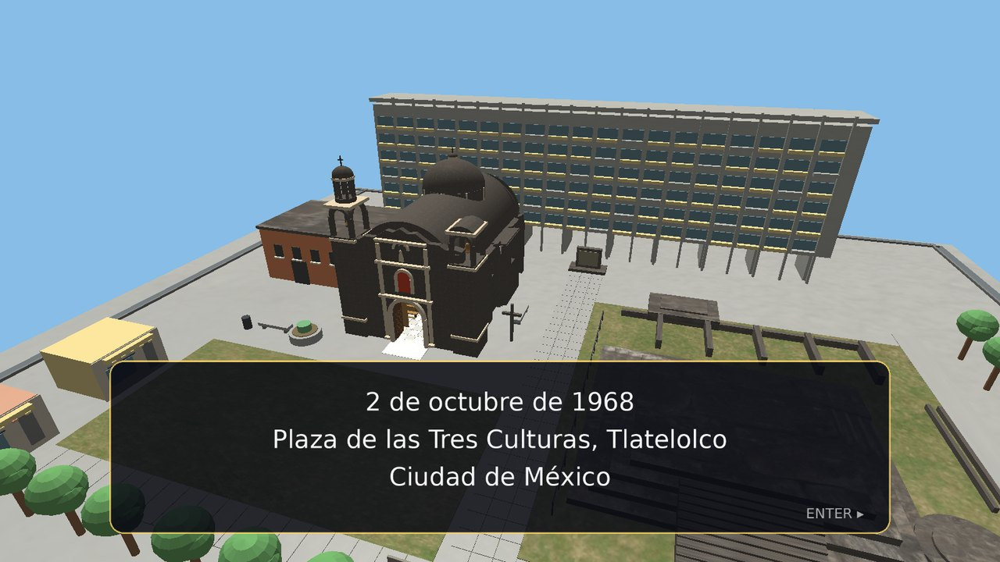

*Figura 1. Introducción: la cámara sobrevuela la plaza y aparece el texto de la historia.*

Verás tres tipos de elementos en pantalla:

| Elemento | Dónde está | Para qué sirve |
|---|---|---|
| **Recuadro de texto** (fondo oscuro, borde dorado) | Parte baja | Cuenta la historia. Pulsa `Enter` para pasar a la siguiente página. |
| **Recuadro de acción** (letras amarillas) | Parte baja | Te dice qué tecla pulsar para continuar. |
| **Aviso rojo** «Tecla incorrecta» | Sobre el recuadro de acción | Solo en la escena 4, si pulsas la flecha equivocada. |

No hay menús, ni cursor, ni barra de estado.

---

## 5. Controles

### 5.1 Controles del relato

| Tecla | Qué hace |
|---|---|
| **`Enter`** | Avanza: pasa a la siguiente página de texto o a la siguiente escena. |
| **`Espacio`** | Acción principal de la escena (dar un martillazo, despertar a CUAU-68, levantar la MAC, golpear…). |
| **`←`** y **`→`** | Solo en la escena 4: esquivar. |
| **`Esc`** | Cierra el programa. |

**Reglas que conviene conocer**

- Mientras la cámara se mueve o una animación está en curso, el teclado se **ignora**. Espera a que aparezca el recuadro amarillo.
- Si pulsas una tecla que no corresponde a la escena, no pasa nada.
- No se puede retroceder ni saltar escenas durante el uso normal.
- La cámara y los personajes no se mueven con el ratón ni con `W A S D`.

---

## 6. Guía de la historia, escena por escena

Cada escena sigue el mismo ritmo: **texto** (`Enter`) → **viaje de cámara** → **tu acción** (recuadro amarillo) → **animación** → `Enter` para continuar. Las escenas 0 y 9 invierten el orden: primero la cámara y después el texto.

### Escena 0 — Introducción

- **Qué verás:** la plaza desde lo alto y tres páginas de texto: la fecha (2 de octubre de 1968, Plaza de las Tres Culturas), lo ocurrido esa tarde y el sentido del homenaje (una ficción con robots que representa la valentía de las y los estudiantes y la fuerza que quiso callarla).
- **Qué hacer:** pulsa `Enter` tras cada página y, al final, `Enter` para continuar.

### Escena 1 — Obreros construyen a CUAU-68

- **Qué verás:** sobre la pirámide, CUAU-68 está tendido; seis obreros (UNAM e IPN) lo rodean con martillos. El texto cuenta cómo nace CUAU-68, su significado y quiénes lo construyen.
- **Qué hacer:**
  1. Pulsa **`Espacio`** tres veces para dar los **3 martillazos** (el recuadro cuenta 0/3, 1/3, 2/3). Espera a que termine cada golpe.
  2. Cuando aparezca *«Presiona ESPACIO para despertar a CUAU-68»*, pulsa `Espacio` otra vez.
- **Qué pasa:** CUAU-68 se incorpora y **las luces de su casco se encienden y pulsan** suavemente.

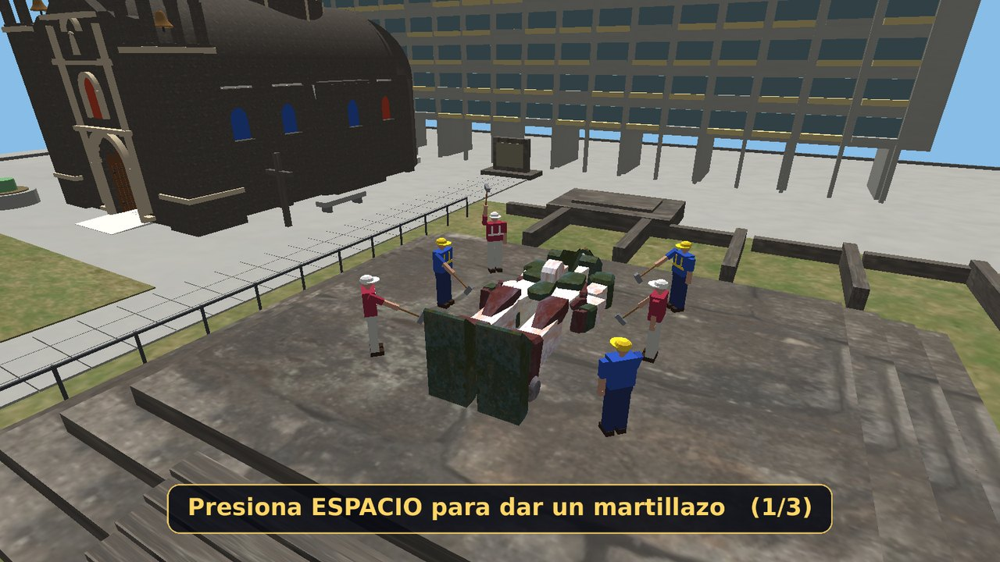

*Figura 2. Escena 1: los obreros dan martillazos a CUAU-68, que yace sobre la pirámide.*

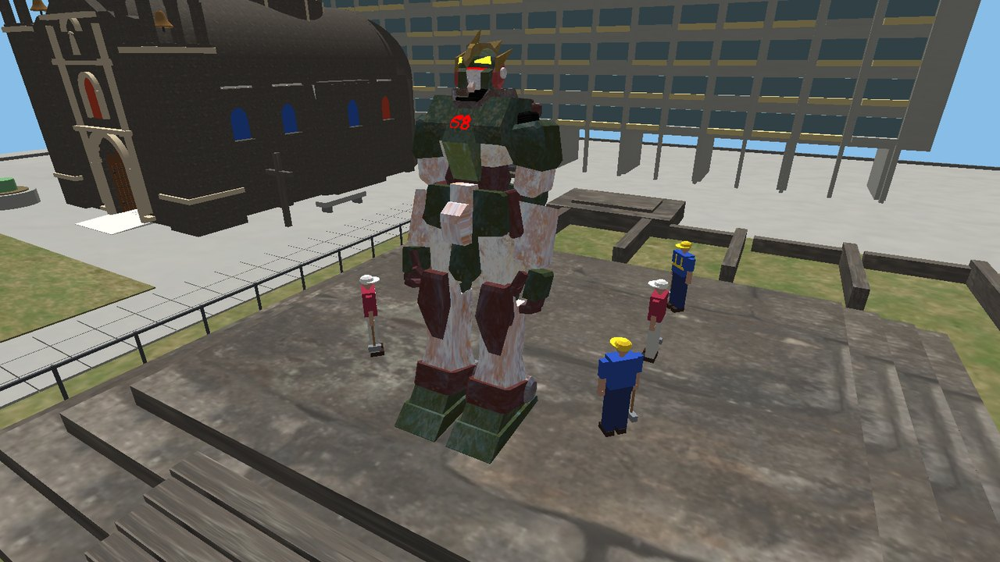

*Figura 3. Escena 1: CUAU-68 se incorpora y enciende las luces del casco.*

### Escena 2 — Salen los SENTINEL

- **Qué verás:** del Templo de Santiago salen, **en fila**, tres SENTINEL MX caminando con su railgun en la mano. El texto explica quiénes son y qué recuerda la iglesia.
- **Qué hacer:** nada; es automática. Al terminar, pulsa `Enter`.

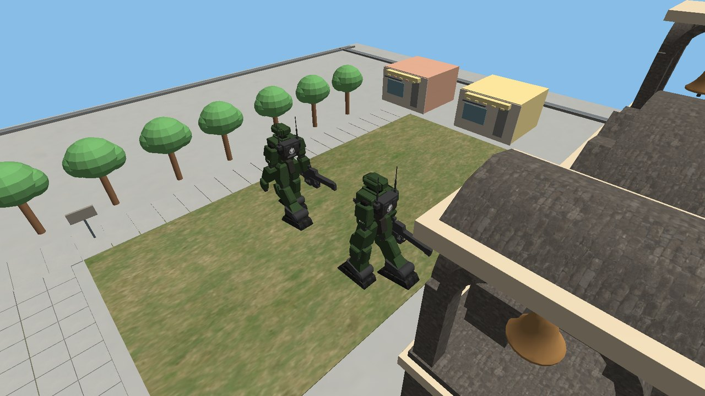

*Figura 4. Escena 2: los SENTINEL MX avanzan en fila desde el templo.*

### Escena 3 — CUAU-68 levanta la MAC

- **Qué verás:** CUAU-68, ya en pie, empuña la MAC.
- **Qué hacer:** pulsa **`Espacio`** para levantarla.
- **Qué pasa:** CUAU-68 alza la MAC, **mira hacia arriba** y las **sierras de obsidiana empiezan a girar** (en sentidos alternos).

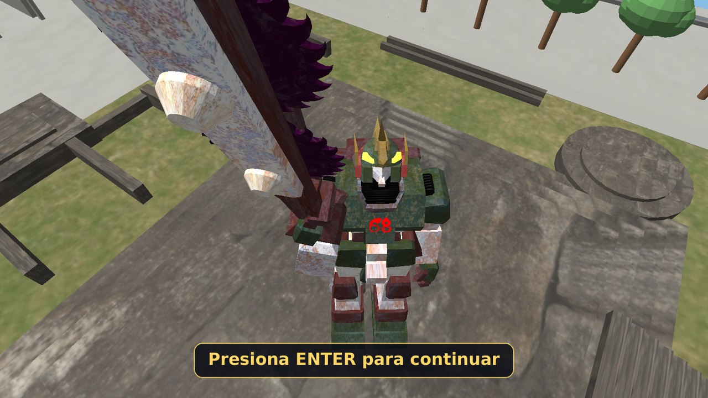

*Figura 5. Escena 3: CUAU-68 levanta la MAC y mira hacia arriba.*

### Escena 4 — Sprint esquivando

- **Qué verás:** la cámara queda detrás de los tres SENTINEL, que forman una fila y apuntan a CUAU-68. CUAU-68 espera sobre la pirámide.
- **Qué hacer:** pulsa las flechas **en este orden: `←`, `→`, `←`**. El recuadro indica cuál toca (1/3, 2/3, 3/3).
  - Cada flecha correcta lanza **un esquive**: CUAU-68 salta hacia ese lado **de la pantalla** y avanza hacia los SENTINEL.
  - Si pulsas la flecha equivocada, aparece **«Tecla incorrecta»** y no pasa nada más.
- **Qué pasa:** mientras esquivas, los SENTINEL **barren** el terreno con sus armas, que **retroceden** al disparar con un **destello de luz**. No hay balas.

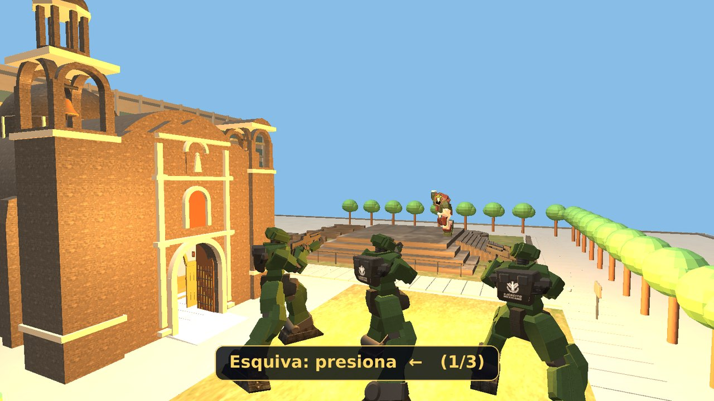

*Figura 6. Escena 4: los SENTINEL apuntan; el recuadro pide la primera flecha.*

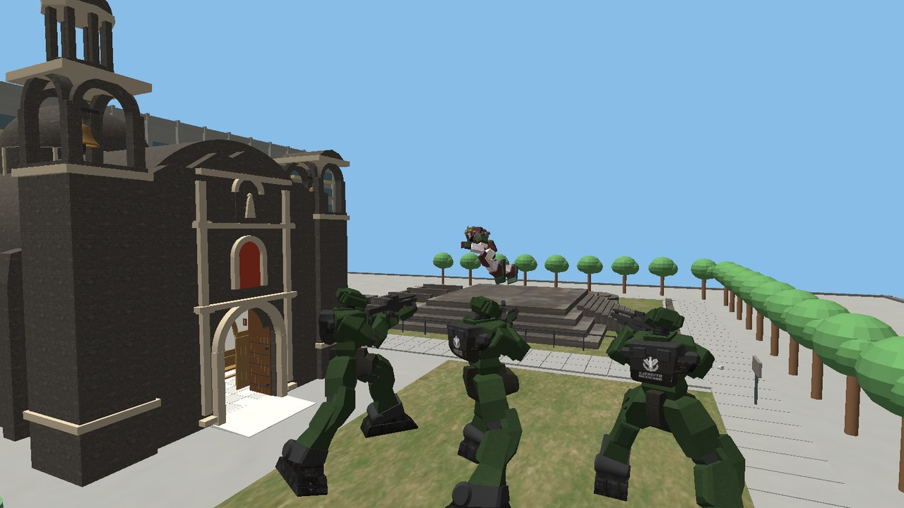

*Figura 7. Escena 4: CUAU-68 salta hacia la izquierda de la pantalla mientras los SENTINEL disparan.*

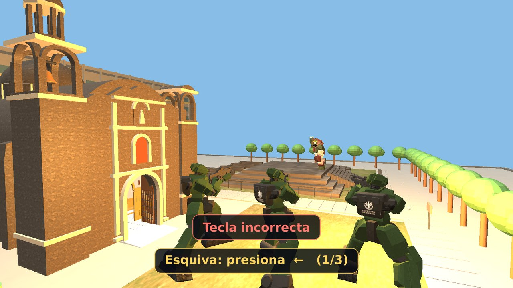

*Figura 7b. Escena 4: si pulsas la flecha equivocada aparece el aviso rojo «Tecla incorrecta» y la secuencia no avanza.*

### Escenas 5 y 7 — La MAC cae sobre un SENTINEL

- **Qué verás:** CUAU-68 frente a un SENTINEL.
- **Qué hacer:** pulsa **`Espacio`** (*«…golpear con la MAC»* en la escena 5; *«…el golpe final»* en la 7).
- **Qué pasa:** CUAU-68 camina hacia el SENTINEL, levanta la MAC y la azota; el SENTINEL **cae hacia atrás y rebota** contra el suelo.

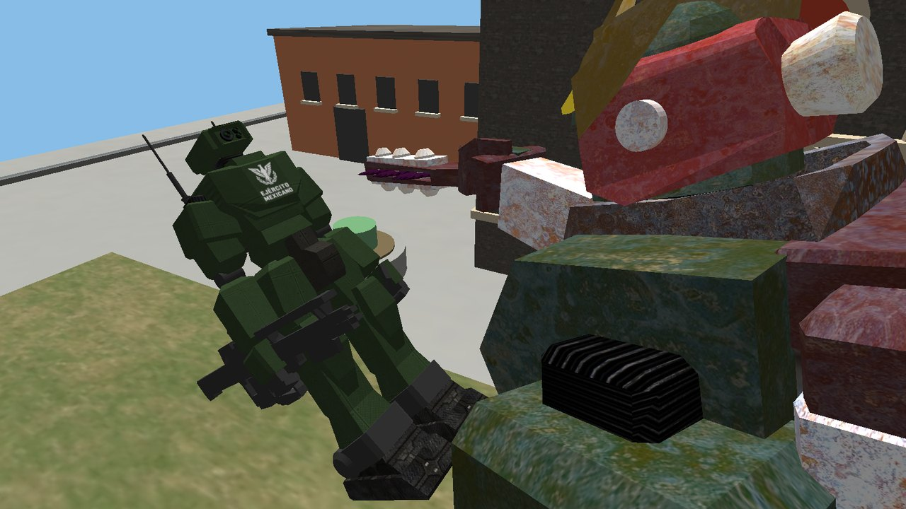

*Figura 8. Escena 5: el azote con la MAC.*

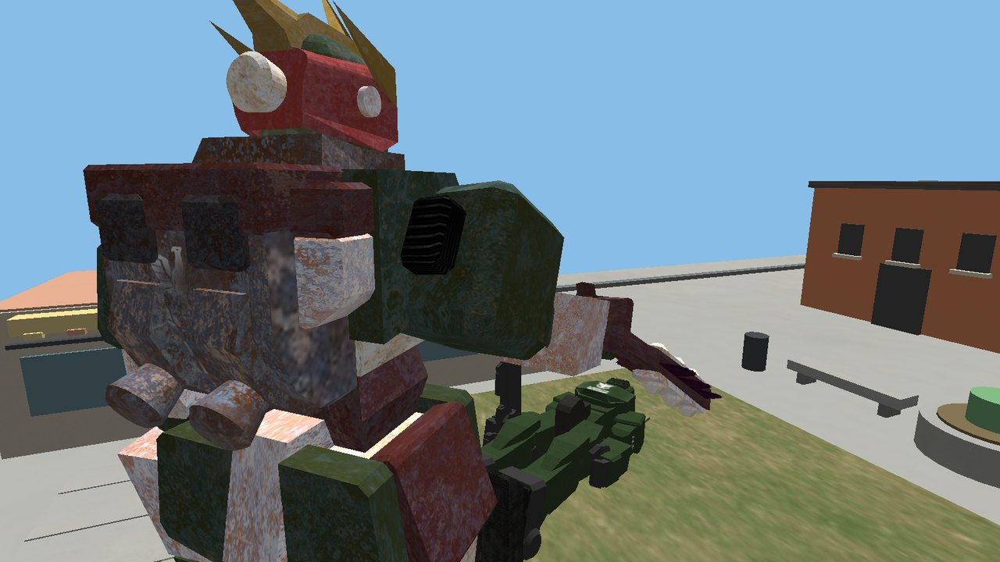

*Figura 9. Escena 7: el último SENTINEL cae bajo la MAC.*

### Escena 6 — El puñetazo

- **Qué hacer:** pulsa **`Espacio`** (*«…dar el golpe»*).
- **Qué pasa:** CUAU-68 se acerca y golpea en la cara a otro SENTINEL con el puño izquierdo; este cae hacia atrás.

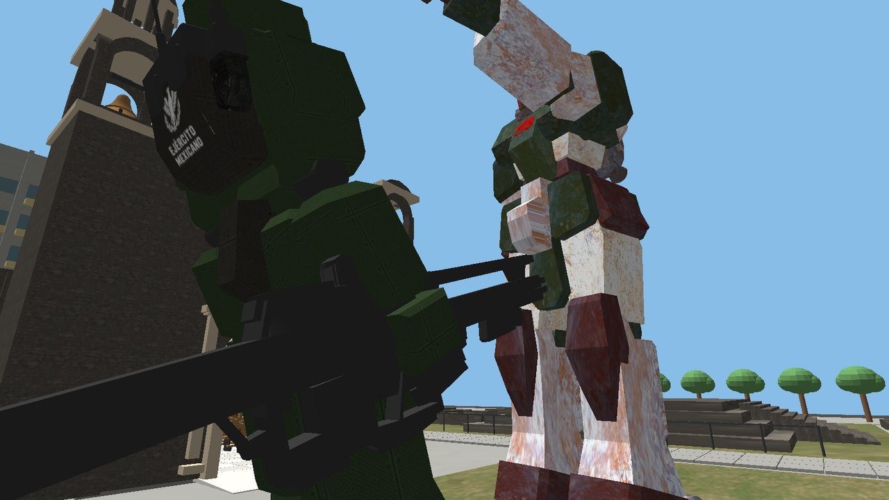

*Figura 10. Escena 6: el puñetazo de CUAU-68.*

### Escena 8 — Victoria

- **Qué verás:** los tres SENTINEL yacen derribados y sus railguns quedaron en el suelo.
- **Qué hacer:** pulsa **`Espacio`** (*«…alzar la MAC»*).
- **Qué pasa:** CUAU-68 **alza la MAC** con las sierras girando, en silencio.

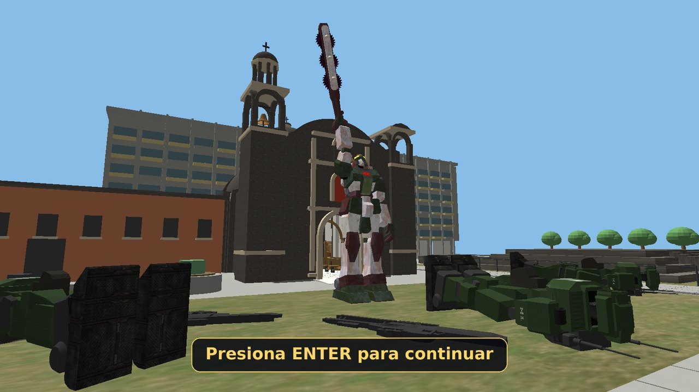

*Figura 11. Escena 8: CUAU-68 alza la MAC; los SENTINEL derribados y sus railguns, en el piso.*

### Escena 9 — La lápida

- **Qué verás:** la cámara viaja hasta la **lápida conmemorativa**, en la zona contemporánea de la plaza, y aparecen tres páginas de texto sobre la memoria: *«2 de octubre no se olvida»*.
- **Qué hacer:** pulsa `Enter` en cada página. En la última pantalla, `Enter` **cierra** el programa (o `Esc` para salir).

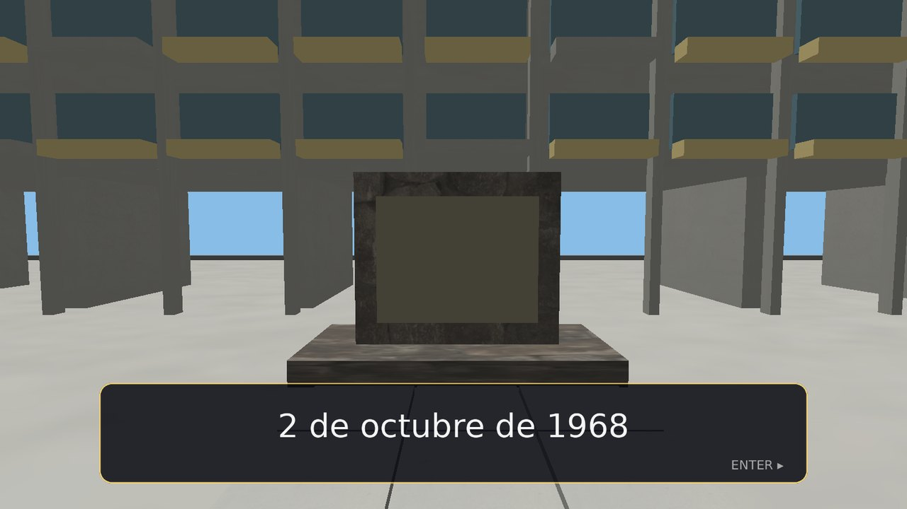

*Figura 12. Escena 9: la lápida, con el texto de cierre.*

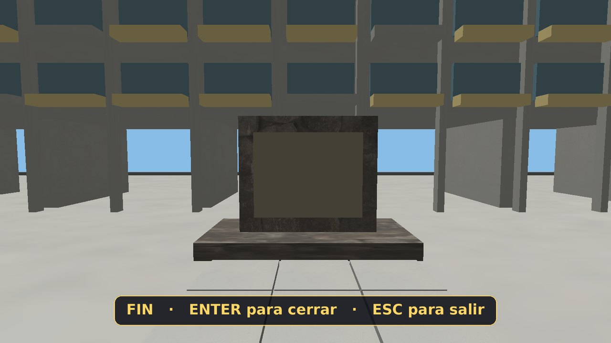

*Figura 13. Pantalla final: «FIN · ENTER para cerrar · ESC para salir».*

---

## 7. Las cinco animaciones

Todas las animaciones se generan **por código**; no hay animaciones de Blender ni videos. Las cinco que se presentan como oficiales son:

| N.º | Animación | Tipo | Dónde se ve |
|---|---|---|---|
| 1 | **Giro de las sierras de la MAC** (sentidos alternos) | Sencilla | Escenas 3, 5, 7 y 8 |
| 2 | **Luces del casco de CUAU-68** que se encienden y pulsan con un seno | Sencilla | Desde la escena 1 |
| 3 | **Caída del SENTINEL** con rebote | Sencilla | Escenas 5, 6 y 7 |
| 4 | **Barrido de los SENTINEL**: giro senoidal, vibración, retroceso del railgun y destello de luz sincronizados | Compleja | Escena 4 |
| 5 | **Sprint esquivando de CUAU-68**: salto, desplazamiento lateral, giro suavizado hacia la velocidad e inclinación | Compleja | Escena 4 |

Además hay movimientos de apoyo, también por código: los martillazos de los obreros, la caminata de los SENTINEL al salir del templo, el puñetazo y el azote de CUAU-68. Las fórmulas de todas se explican en el **manual técnico**.

---

## 8. Modo desarrollador (opcional)

Sirve para **revisar y ajustar** las escenas; no hace falta para ver la historia. Todo lo de esta sección se activa con teclas que el relato normal no usa.

### 8.1 Teclas del modo desarrollador

| Tecla | Qué hace |
|---|---|
| **`AvPág` / `RePág`** | Salta a la escena siguiente / anterior (también `]` y `[` en teclado inglés). La escena queda lista para ver su acción. |
| **`F1`** | Cámara libre: `W A S D` o las flechas la mueven y el ratón la gira. Empieza donde estaba la cámara del relato. |
| **`C`** | Imprime en la terminal la posición y el punto de mira de la cámara. |
| **`F3`** | Modo edición: mueve a los actores de la escena actual (ver 8.2). |
| **`F2`** | Cambia entre el relato y el *banco de pruebas* (ver 8.3). |

### 8.2 Modo edición (`F3`)

Con `F3` activado, el programa imprime la ayuda en la terminal.

| Tecla | Qué hace |
|---|---|
| `TAB` | Elige el actor: CUAU, SENTINEL 1 a 3 u OBREROS (solo entre los visibles). |
| `J` / `L` | Mueve a la izquierda / derecha (eje X). |
| `I` / `K` | Mueve atrás / adelante (eje Z). |
| `U` / `O` | Sube / baja. |
| `Q` / `E` | Gira. |
| `P` | Imprime posiciones absolutas y ajustes de la escena. |

Los ajustes se **guardan solos** en el archivo `ajustes_escenas.txt` (en la carpeta desde donde se ejecuta el programa) y se cargan al abrir. Para volver a la configuración original, **borra ese archivo**. En la escena 4 los tres SENTINEL se mueven como grupo.

### 8.3 Banco de pruebas (`F2`)

Muestra las mallas de pose y los modelos por partes sin el relato. Con la cámara libre activa:

| Tecla | Qué hace |
|---|---|
| `W A S D` / flechas y ratón | Mueven y giran la cámara. |
| `TAB`, `J L I K U O`, `Q E`, `Z X` | Eligen un grupo y lo mueven, giran y escalan. |
| `P` | Imprime escalas, giros y posiciones. |
| `N`, `B`, `V` | Activan o detienen las sierras, el barrido de los SENTINEL y el esquive de CUAU-68. |
| `G` | Alterna entre las mallas de pose y los modelos por partes (con caminata). |
| `R` | Con `G`: deja los modelos quietos en pose T. |
| `H` | Enciende o apaga el visor, las luces del casco y el «68» de CUAU-68. |
| `F` | Muestra el círculo de obreros; `Espacio` da un martillazo. |

### 8.4 Opciones de línea de comandos

Sirven para probar una escena concreta o tomar capturas sin usar el teclado:

```bash
./proyecto_lab_main --escena 5                      # empieza en la escena 5, lista para la acción
./proyecto_lab_main --escena 4 --teclas 0.2:LEFT    # simula una flecha izquierda a los 0.2 s
./proyecto_lab_main --escena 3 --cam -8 5 12 -12 5 8   # cámara fija: posición y punto de mira
./proyecto_lab_main --escena 8 --teclas 0.3:SPACE --foto captura.png 3.5   # guarda una captura a los 3.5 s y cierra
```

Teclas simulables en `--teclas`: `SPACE`, `ENTER`, `LEFT`, `RIGHT`, `PGDN`, `PGUP`, `TAB`, `F3` y cualquier letra.

---

## 9. Problemas frecuentes

| Síntoma | Causa probable | Qué hacer |
|---|---|---|
| CMake dice que no encuentra `glfw3` o `assimp` | Falta el paquete de desarrollo | Instala `libglfw3-dev` y `libassimp-dev` y repite `cmake -S . -B build`. |
| `Failed to create GLFW window` | No hay sesión gráfica o el controlador no ofrece OpenGL 3.3 | Ejecuta desde un escritorio con aceleración gráfica y revisa el controlador. |
| `Failed to initialise GLAD` | El contexto OpenGL no se creó | Igual que el anterior; no basta con tener las cabeceras instaladas. |
| `ERROR::SHADER::…` o pantalla sin objetos | Faltan los shaders o no compilan | Ejecuta desde `build/proyecto_lab` y comprueba que existe `Shader/lighting.vs`, `lighting.frag`, `hud.vs` y `hud.frag`. |
| `ERROR::ASSIMP::…` | Falta algún modelo | Revisa que `Models/` esté completa y que los nombres respeten mayúsculas y minúsculas. |
| `HUD: no se pudo cargar UI/xxx.png` | Falta la carpeta `UI/` o algún texto | Ejecuta desde `build/proyecto_lab` (o junto a la carpeta `UI/`). Sin ella la historia se ve, pero **sin textos**. |
| Pantalla negra o personajes sin textura | Rutas relativas rotas | No muevas el ejecutable fuera de `build/proyecto_lab`. |
| La historia parece «atascada» | Una animación está en curso o la cámara se mueve | Espera al recuadro amarillo; el teclado se ignora mientras tanto. |
| La flecha no responde en la escena 4 | Es la flecha equivocada de la secuencia | Sigue el orden `←`, `→`, `←` que indica el recuadro. |
| Los personajes aparecen en lugares distintos a los de las capturas | Existe un `ajustes_escenas.txt` con ajustes del modo edición | Bórralo y vuelve a abrir el programa. |
| El programa se cerró de repente | Se pulsó `Esc`, o falló la ventana | Vuelve a ejecutarlo desde la terminal y conserva los mensajes que imprima. |
| Va lento | Controlador sin aceleración (renderizado por software) | Comprueba que el sistema usa la GPU; el renderizador debe nombrar tu tarjeta, no «llvmpipe». |

---

## 10. Créditos y recursos

| Recurso | Autoría y procedencia |
|---|---|
| Modelo de la **Plaza de las Tres Culturas** (plaza, iglesia, edificio, vestigios, lápida, árboles, mobiliario) | Víctor, del equipo de teoría de la asignatura (modelo reutilizado con su crédito). |
| **CUAU-68**, **SENTINEL MX**, **MAC** y **obreros** | Modelados en Blender por el equipo. Los conceptos visuales de CUAU-68 y SENTINEL se generaron con ChatGPT y se usaron como referencia de diseño. |
| **Portada** | Generada con ChatGPT a partir de capturas de los modelos de Blender. |
| **Asistencia** | Gemini: consultor conceptual y guía para Blender. Claude: asistencia de programación e implementación. |
| **Texturas** de los robots y la plaza | **[PENDIENTE: procedencia y licencia de cada textura]** |
| **Textos del HUD** | Imágenes PNG generadas con Python y Pillow, con la fuente DejaVu Sans (licencia libre). |
| Software | OpenGL, GLFW, GLAD, GLM, SOIL2 y Assimp (código base de la asignatura y bibliotecas libres); Blender y Python para el modelado y las imágenes de texto. |

---

## 11. Aviso sobre el contenido

El 2 de octubre de 1968, en la Plaza de las Tres Culturas de Tlatelolco, una concentración estudiantil fue reprimida con violencia. Muchas personas murieron o resultaron heridas, y su memoria sigue viva.

Este proyecto es una **ficción** hecha con respeto y con fines académicos y no comerciales: dos robots, CUAU-68 y los SENTINEL MX, representan la valentía de las y los estudiantes y la fuerza que quiso callarla. No muestra violencia contra personas. La zona arqueológica y el entorno son una **recreación estilizada**, no un levantamiento arquitectónico.

---

## 12. Glosario

| Término | Significado |
|---|---|
| **Escena** | Cada uno de los 10 momentos de la historia. |
| **HUD** | Los recuadros de texto dibujados sobre la imagen 3D. |
| **MAC** | Mecanismo Acelerador de Cadena, el arma de CUAU-68. |
| **SENTINEL MX** | Los robots del gobierno (el ejército). |
| **CUAU-68** | Coraza Unificada de Acción Universitaria. |
| **Railgun** | Arma de los SENTINEL; en el programa se representa con retroceso y un destello de luz, sin balas. |
| **Modo desarrollador** | Teclas opcionales para revisar y ajustar las escenas. |
| **Shader** | Programa que ejecuta la GPU para calcular la forma y el color de lo que se dibuja. |
| **OBJ / MTL** | Archivos de geometría y de materiales de los modelos 3D. |
