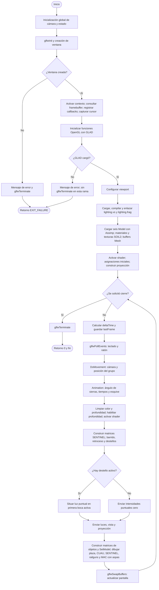

# Flujo del software

La cámara se construye antes de entrar a main. Después de cargar los recursos, el programa repite la lectura de entradas, la actualización y el dibujo hasta que se solicita el cierre. Los errores de ventana y GLAD sí retornan; los de carga de modelos o shaders se informan sin una decisión general de salida. El archivo draw.io conserva nodos y conectores editables, con esta explicación debajo del flujo.
