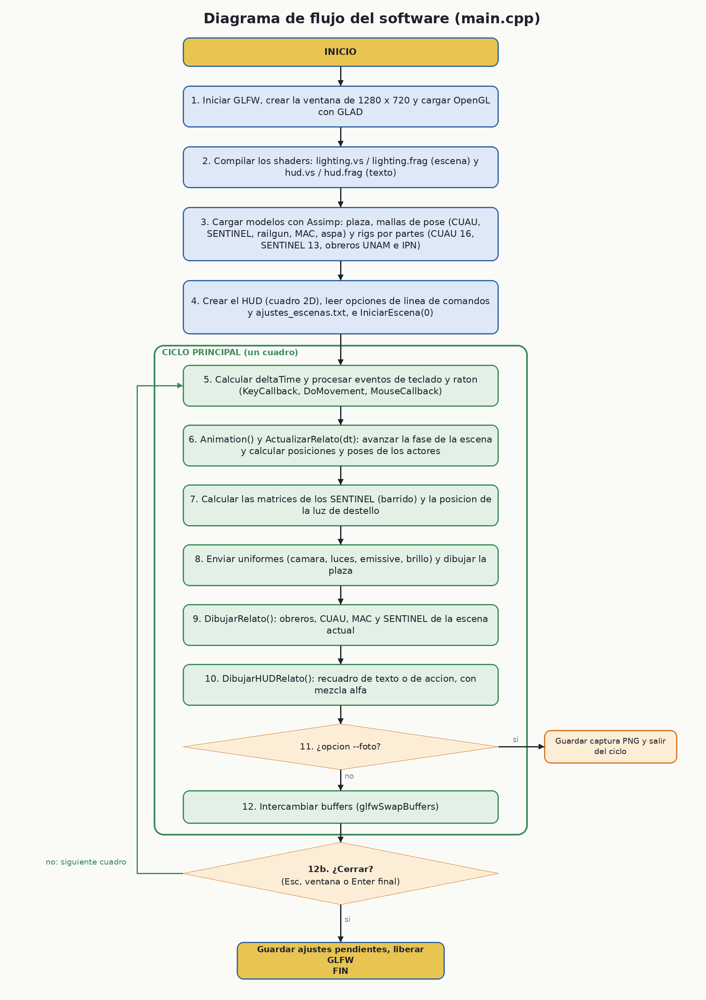
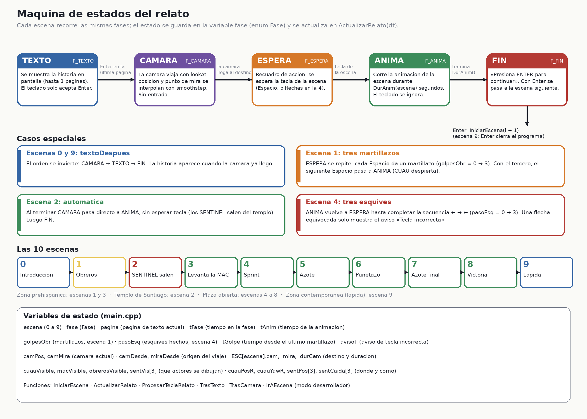

# Diagramas

| Imagen | Fuente editable | Descripción |
|---|---|---|
|  | [flujo_programa.mmd](flujo_programa.mmd) | Diagrama de flujo del software. |
|  | [maquina_de_estados.mmd](maquina_de_estados.mmd) | Máquina de estados del relato. |

El Gantt está en [../gestion](../gestion/Explicacion_Gantt.md). Las imágenes se regeneran con `generar_diagramas.py` (requiere Pillow); los `.mmd` se pueden abrir en cualquier visor de Mermaid.
