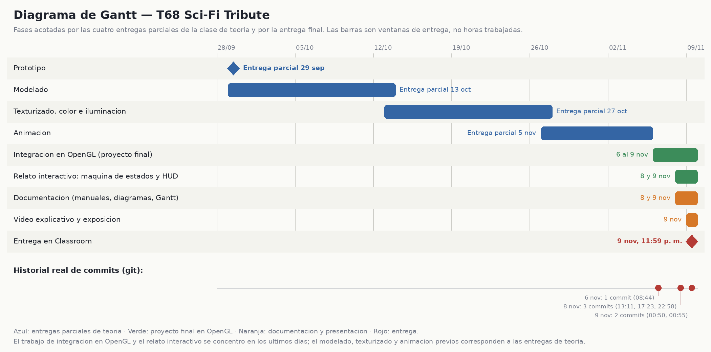

# Explicación del diagrama de Gantt

Archivos relacionados: [`Gantt_Proyecto.mmd`](Gantt_Proyecto.mmd) (versión editable en Mermaid), [`Cronograma.csv`](Cronograma.csv) (los mismos datos en tabla) y [`../diagramas/generar_diagramas.py`](../diagramas/generar_diagramas.py) (genera la imagen).

## 1. Cómo se construyó

El proyecto final se integró y programó en los últimos días antes de la entrega, por lo que **no existe un registro de fechas de trabajo día por día** para todo el proyecto. Para no inventar un historial, el diagrama se apoya en dos fuentes verificables:

1. **Las cuatro entregas parciales de la clase de teoría**, que marcan el avance de los modelos y animaciones usados después en OpenGL:

   | Entrega | Fecha |
   |---|---|
   | Prototipo | 29 de septiembre de 2026 |
   | Modelado | 13 de octubre de 2026 |
   | Texturizado, color e iluminación | 27 de octubre de 2026 |
   | Animación | 5 de noviembre de 2026 |

2. **El historial real de `git`**, para las fases de integración, relato y documentación (6 al 9 de noviembre).

## 2. Cómo leerlo

- Cada barra azul va **de una entrega parcial a la siguiente**: representa la *ventana* disponible para esa etapa, no las horas trabajadas. El **Prototipo** es un hito, porque no se conoce su fecha de inicio.
- Las barras verdes (integración en OpenGL y relato) y naranjas (documentación, video y exposición) corresponden al proyecto final.
- Los puntos rojos de la línea inferior son los **commits reales**:

  | Fecha | Commits | Qué contienen |
  |---|---|---|
  | 6 nov, 08:44 | `e128f2b` | Estructura inicial: plaza, CUAU-68, SENTINEL y MAC con animaciones por código (`main.cpp` de 357 líneas) |
  | 8 nov, 13:11 | `c4d5933` | CMake raíz y `.gitignore` |
  | 8 nov, 17:23 | `2caa3f9` | Primera versión de la documentación (PR #1) |
  | 8 nov, 22:58 | `d4644c7` | Modelos con materiales completos y por partes, máquina de estados del relato, HUD y textos (`main.cpp`: 839 líneas cambiadas) |
  | 9 nov, 00:50 | `99ef023` | Ajustes de las escenas y de los textos del HUD |
  | 9 nov, 00:55 | `0024f94` | Integración del PR #1 en `main` |

## 3. Lectura honesta del calendario

- El **modelado, el texturizado y la animación** de los personajes se hicieron en el marco de las entregas de teoría; los archivos de Blender son su evidencia, pero no hay fechas por tarea.
- La **integración en OpenGL, el relato interactivo y la documentación** se concentraron del 6 al 9 de noviembre. Es una limitación de planeación, no un resultado deseable, y se reconoce como tal en las conclusiones del [manual técnico](../Manual_Tecnico.md).
- El diagrama no pretende acreditar horas ni responsables; los responsables de cada fase quedan pendientes de completar por el equipo.

## 4. Pendientes de este documento

- **[PENDIENTE]** Responsables de cada fase.
- **[PENDIENTE]** Fecha de grabación del video y de la exposición oral.
