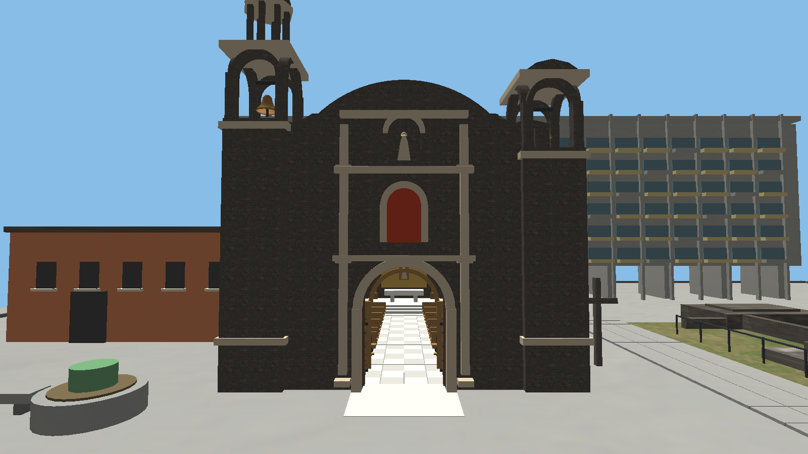
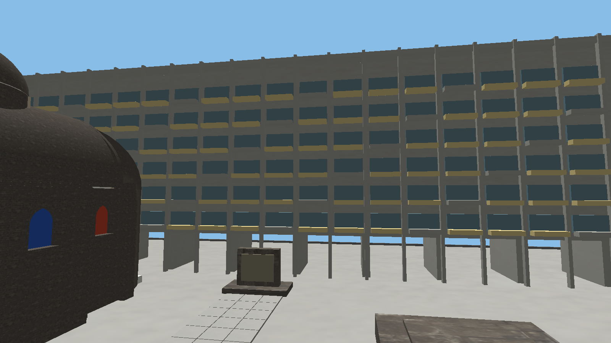
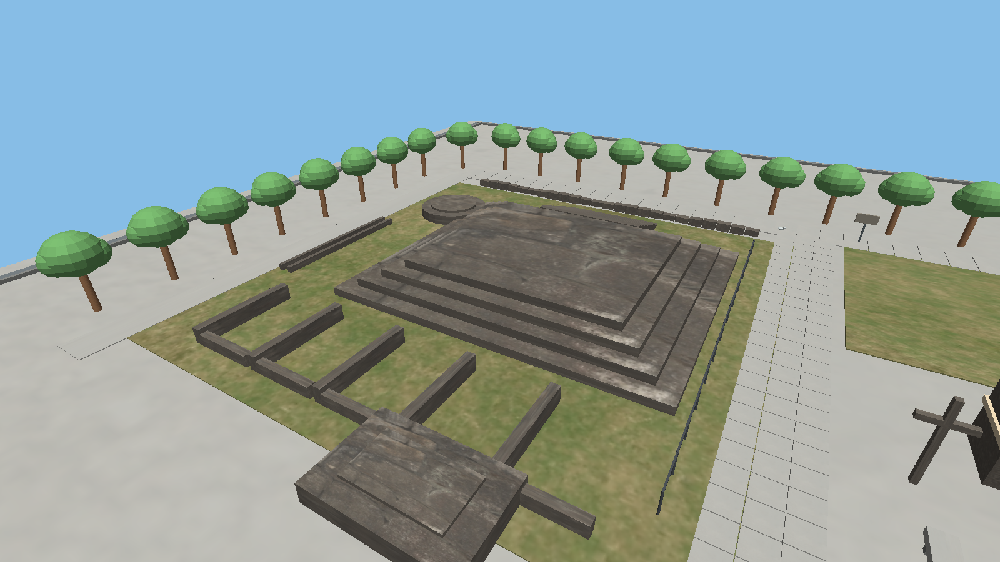
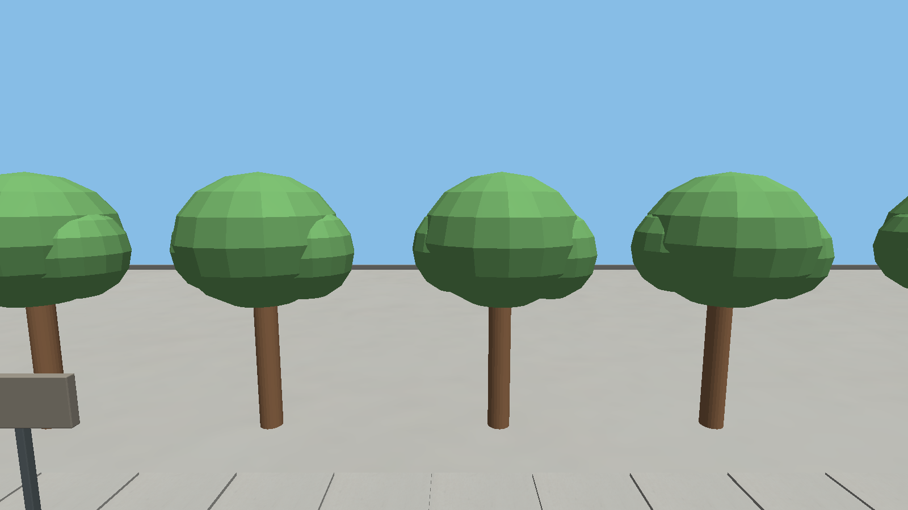
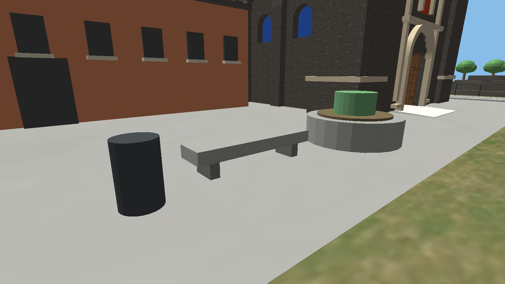
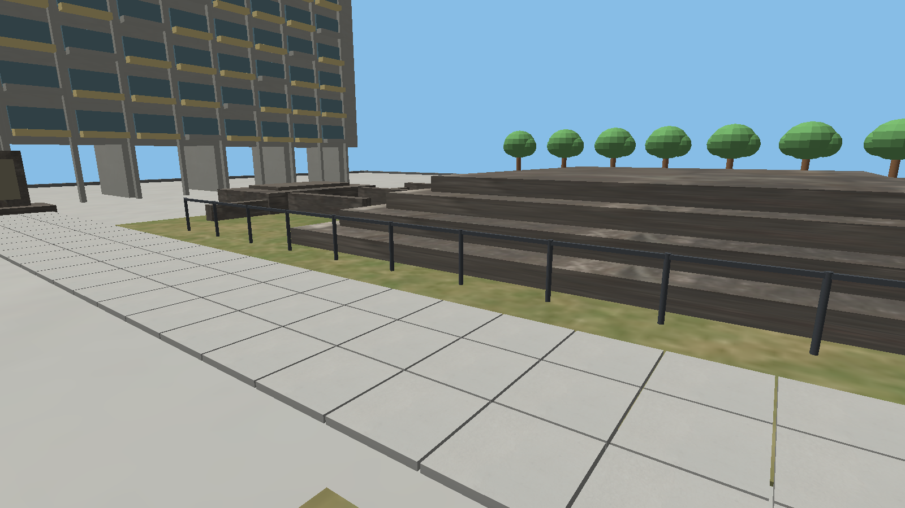
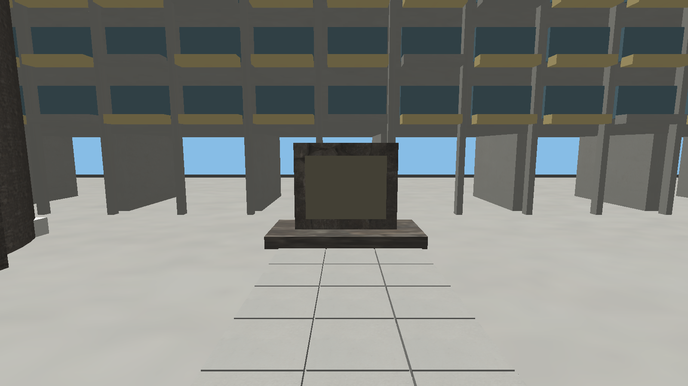

# Comparativa de Tlatelolco: fotografías y representación 3D

## 1. Alcance de la comparación

Se localizaron fichas fotográficas verificables y se inspeccionaron nombres, vértices y materiales de `proyecto_lab/Models/plaza/plaza.obj`. Las capturas del modelo (C-01 a C-07, carpeta `capturas/`) se generaron con el programa: `./proyecto_lab_main --escena 0 --sinhud --cam px py pz mx my mz --foto archivo.png 12`. Este documento contiene el inventario geométrico y las capturas; la **comparación visual** contra las fotografías la debe valorar el equipo, no es una evaluación de fidelidad ya realizada. Las fotografías enlazadas no se incorporaron como archivos locales ni se presentan como capturas de la aplicación.

Las dimensiones proceden de restar mínimos y máximos de las líneas `v` asociadas a cada objeto o familia de objetos del OBJ. Son cajas alineadas con los ejes de la escena, redondeadas a tres decimales; no son medidas del lugar real ni resultados de fotogrametría. El conteo de vértices es el de registros del OBJ, anterior al procesamiento de Assimp. Los nombres de material señalan intención de apariencia, no acreditan el resultado del shader.

## 2. Tabla de los siete elementos

| Objeto | Fotografía real | Fuente | Captura del modelo | Comparación geométrica y visual |
|---|---|---|---|---|
| Templo de Santiago | [Tlatelolco Templo de Santiago](https://commons.wikimedia.org/wiki/File:Tlatelolco_Templo_de_Santiago.jpg) | F-01: Karycocco, 26/09/2013; CC BY-SA 3.0. |  Captura del modelo (C-01).| `iglesia_por_fuera` contiene 17 352 registros de vértices; caja X/Y/Z ≈ 12.450/15.390/22.950. Asigna piedra de iglesia, cantera de portada, madera y bronce, entre otros materiales. La coincidencia de volúmenes, torres, vanos y proporciones con la fotografía aún no se ha evaluado. |
| Edificio Chihuahua | [Detalles del Edificio Chihuahua 01](https://commons.wikimedia.org/wiki/File:Detalles_del_Edificio_Chihuahua_01.jpg) | F-02: ProtoplasmaKid, 11/11/2022 según ficha; CC BY 4.0. |  Captura del modelo (C-02).| La familia `PASEO_CHIHUAHUA_` suma 2 072 registros; extensión ≈ 51.694/16.906/5.900. Usa concreto moderno, paneles amarillos y vidrio azul gris. La caja indica predominio del ancho sobre el fondo; no permite afirmar número correcto de niveles, exactitud de ventanas ni semejanza de color. |
| Zona arqueológica o plataformas | [Zona arqueológica desde la Plaza de las Tres Culturas 04](https://commons.wikimedia.org/wiki/File:Zona_arqueol%C3%B3gica_de_Tlatelolco_desde_la_Plaza_de_las_Tres_Culturas_04.jpg) | F-03: Luis Alvaz, 23/06/2022; CC BY-SA 4.0. |  Captura del modelo (C-03).| La familia `PASEO_VESTIGIOS_` suma 528 registros; extensión conjunta ≈ 24.188/1.909/30.775. Usa piedra de vestigios y escalinatas. La baja altura frente a la extensión horizontal es comprobable en el archivo. Falta contrastar contornos, desniveles y detalle de aparejo con la referencia. |
| Árboles | [Jardín de Santiago, Tlatelolco](https://commons.wikimedia.org/wiki/File:Jard%C3%ADn_de_Santiago_(Tlatelolco,_CDMX).jpg), referencia de vegetación del entorno, no equivalencia de ubicación confirmada. | F-04: Juan Carlos Fonseca Mata, 27/10/2022; CC BY-SA 4.0. |  Captura del modelo (C-04).| `arbol` y sus copias suman 8 970 registros; altura máxima global 4.375 y mínimo Y=0. Sus materiales son `PASEO_MAT_014` y `015`, sin imagen referida por esos materiales en el MTL. No se identifican especie, dimensiones reales o forma de copa por nombre. Debe obtenerse una fotografía del sector exacto representado. |
| Bancas | **[PENDIENTE F-05]** Fotografía identificable de una banca de la plaza. | No se confirmó una fotografía específica con autoría y licencia suficientes. |  Captura del modelo (C-05).| `banca` y `banca.001` tienen 24 registros cada una. Sus cajas son ≈ 0.750/0.845/3.100 y 3.100/0.845/0.750; sugieren orientaciones distintas por intercambio de extensión X/Z. Ambas usan concreto de andadores y concreto oscuro. No se infiere respaldo, diseño o material real de esa evidencia. |
| Rejas | **[PENDIENTE F-06]** Fotografía del cerramiento correspondiente. | No se seleccionó una imagen; una reja de vivienda en Tlatelolco no basta como referencia de la plaza. |  Captura del modelo (C-06).| `barda` contiene 632 registros, extensión ≈ 0.090/1.100/21.690 y material `MAT_METAL_URBANO_GRAFITO`. Es un candidato documental por su nombre y material, sin equivalencia visual confirmada. Falta verificar barrotes, postes y separación, y descartar que corresponda a otro tipo de límite. |
| Lápida conmemorativa | [Plaza de las Tres Culturas - Memorial 1968](https://commons.wikimedia.org/wiki/File:Plaza_de_las_Tres_Culturas_-_Memorial_1968.JPG) | F-07: ProtoplasmaKid, 11/12/2011; ficha con datos de licencia que requieren aclaración, véase registro. |  Captura del modelo (C-07).| `lapida` contiene 24 registros; caja ≈ 4.000/2.600/2.000. Usa piedra de vestigios, escalinatas y `PASEO_MAT_139`. No se verificaron inscripciones ni se confirmó que el objeto represente exactamente la estela de la fotografía. No debe afirmarse coincidencia de texto o acabado. |

## 3. Registro de fuentes y derechos

Consulta documental: 6 de noviembre de 2026. Las fechas de toma se transcriben de las fichas; no son fechas de consulta ni de incorporación al proyecto.

| ID | Autor y obra | Licencia o condición registrada | Situación |
|---|---|---|---|
| F-01 | Karycocco, *Tlatelolco Templo de Santiago.jpg*. [Ficha](https://commons.wikimedia.org/wiki/File:Tlatelolco_Templo_de_Santiago.jpg). | [CC BY-SA 3.0](https://creativecommons.org/licenses/by-sa/3.0/). | Ficha consultada; conservar autor, título, enlace y licencia al insertar imagen; indicar cualquier recorte. |
| F-02 | ProtoplasmaKid, *Detalles del Edificio Chihuahua 01.jpg*. [Ficha](https://commons.wikimedia.org/wiki/File:Detalles_del_Edificio_Chihuahua_01.jpg). | [CC BY 4.0](https://creativecommons.org/licenses/by/4.0/). | Ficha consultada. Fecha 11/11/2022 en resumen y EXIF; una categoría oculta difiere, por lo que se conserva la fecha de ficha sin asumir verificación independiente. |
| F-03 | Luis Alvaz, *Zona arqueológica de Tlatelolco desde la Plaza de las Tres Culturas 04.jpg*. [Ficha](https://commons.wikimedia.org/wiki/File:Zona_arqueol%C3%B3gica_de_Tlatelolco_desde_la_Plaza_de_las_Tres_Culturas_04.jpg). | [CC BY-SA 4.0](https://creativecommons.org/licenses/by-sa/4.0/). | Fuente localizada con autor, fecha y licencia; falta vista del modelo equivalente. |
| F-04 | Juan Carlos Fonseca Mata, *Jardín de Santiago (Tlatelolco, CDMX).jpg*. [Ficha](https://commons.wikimedia.org/wiki/File:Jard%C3%ADn_de_Santiago_(Tlatelolco,_CDMX).jpg). | [CC BY-SA 4.0](https://creativecommons.org/licenses/by-sa/4.0/). | Ficha consultada; referencia contextual, no sustituto de una foto del árbol o sector exacto. |
| F-05 | Fotografía de banca: pendiente. | Pendiente. | Proporcionar archivo, autor, ubicación y permiso o licencia. |
| F-06 | Fotografía de reja: pendiente. | Pendiente. | Confirmar primero el cerramiento representado. |
| F-07 | ProtoplasmaKid, *Plaza de las Tres Culturas - Memorial 1968.JPG*. [Ficha](https://commons.wikimedia.org/wiki/File:Plaza_de_las_Tres_Culturas_-_Memorial_1968.JPG). | El bloque Licensing y datos estructurados indican [CC BY-SA 3.0](https://creativecommons.org/licenses/by-sa/3.0/); una nota de atribución del autor menciona 4.0. | Se conserva el enlace y la discrepancia. Aclarar la licencia aplicable o elegir otra fotografía antes de incorporar el archivo. No se reprodujo aquí. |

Como fuente institucional adicional se localizó [Tlatelolco, donde se unen las tres culturas, INAH](https://www.inah.gob.mx/foto-del-dia/tlatelolco-donde-se-unen-las-tres-culturas), cuyo resultado de búsqueda acredita a Melitón Tapia. La apertura devolvió HTTP 403: no se obtuvo la imagen ni se verificó una licencia de reutilización. Queda como referencia localizada, sin completar esos datos por inferencia. La [ficha de Tlatelolco del INAH](https://lugares.inah.gob.mx/es/node/4477) puede utilizarse como punto de consulta institucional, sin atribuir automáticamente derechos de reproducción a sus imágenes.

Se descartó como referencia de la lápida el archivo [Memorial de Tlatelolco.jpg](https://commons.wikimedia.org/wiki/File:Memorial_de_Tlatelolco.jpg): su descripción lo sitúa en el Museo Casa de la Memoria Indómita. El nombre del archivo no demuestra que sea el objeto de la plaza.

## 4. Cómo completar la comparación

Obtener una captura por elemento con las animaciones apartadas del encuadre, sin alterar fuentes ni modelos. Para proporciones, usar vistas frontal y lateral; para distribución, una vista elevada. Registrar posición de cámara si se dispone de ella; P solo imprime posiciones de grupos, no coordenadas de cámara.

Comparar primero silueta y relaciones entre ancho, altura y fondo. Después revisar repetición de módulos, vanos, escaleras, bases, postes y detalles presentes u omitidos. Registrar semejanzas y diferencias observables en ambos lados. Para colores y materiales, considerar que la foto y el render tienen iluminación distinta y que el código tiene discrepancias de samplers pendientes de validación. No deducir una escala en metros a partir de las unidades del OBJ.

Al insertar una fotografía, agregar un pie con autor, título, URL de ficha, licencia y cambios efectuados. Las capturas del programa deben identificarse como tales y consignar la versión. Las atribuciones de modelos y texturas del repositorio todavía deben confirmarse con el equipo; la licencia de una fotografía de referencia no se transmite al modelo por tratar el mismo lugar.
